# Hornet v2: High-Level and Low-Level Design

> **What this document is.** A design description of Hornet v2 derived from the actual repository (`backend/`, `twin-image/`, `main-server/`, `demo-servers/`, `docker-compose.yml`, `README.md`, `AGENTS.md`). It describes what the code does today and flags what is only planned.
>
> **Status legend used throughout**
>
> | Tag | Meaning |
> |---|---|
> | **[Implemented]** | Found in the code. |
> | **[Planned]** | Described in `README.md` / `AGENTS.md` but not present in the code. |
> | **[Assumption]** | My reading where the code or docs do not say it outright. Please confirm. |
>
> File paths are relative to the repository root. Line numbers are quoted only where they were checked directly and may drift as the code changes.

---

## Table of Contents

**Part A: High-Level Design (HLD)**
1. [Purpose, goals and requirements](#a1-purpose-goals-and-requirements)
2. [Architecture overview](#a2-architecture-overview)
3. [Major components and responsibilities](#a3-major-components-and-responsibilities)
4. [Data flow](#a4-data-flow)
5. [Deployment view](#a5-deployment-view)
6. [Security architecture and trust boundaries](#a6-security-architecture-and-trust-boundaries)
7. [Key design decisions and trade-offs](#a7-key-design-decisions-and-trade-offs)

**Part B: Low-Level Design (LLD)**
1. [Code and module map](#b1-code-and-module-map)
2. [Database schema](#b2-database-schema)
3. [REST API reference](#b3-rest-api-reference)
4. [Authentication and authorization](#b4-authentication-and-authorization)
5. [Configuration and execution policy](#b5-configuration-and-execution-policy)
6. [Detailed workflows](#b6-detailed-workflows)
   - [6.1 Environment build pipeline](#b61-environment-build-pipeline)
   - [6.2 Sanitization pipeline](#b62-sanitization-pipeline)
   - [6.3 Snapshot lifecycle](#b63-snapshot-lifecycle)
   - [6.4 Session lifecycle (state machine)](#b64-session-lifecycle-state-machine)
   - [6.5 Creating a session](#b65-creating-a-session)
   - [6.6 Executing a command](#b66-executing-a-command)
   - [6.7 SSH gateway connection](#b67-ssh-gateway-connection)
   - [6.8 Reaper and restart reconciliation](#b68-reaper-and-restart-reconciliation)
   - [6.9 AI provider call](#b69-ai-provider-call)
7. [Runtime hardening details](#b7-runtime-hardening-details)
8. [Event model](#b8-event-model)
9. [Error handling and failure modes](#b9-error-handling-and-failure-modes)
10. [Testing strategy](#b10-testing-strategy)
11. [Observability and logging](#b11-observability-and-logging)

**Part C: [Assumptions, gaps and risks](#part-c-assumptions-gaps-and-risks)**

**Part D: [The system end to end](#part-d-the-system-end-to-end)**

**Part E: [How to present the HLD and LLD diagrams](#part-e-how-to-present-the-hld-and-lld-diagrams)**

**Appendix:** [Glossary](#appendix-a-glossary) · [File reference index](#appendix-b-file-reference-index)

---

# Part A: High-Level Design (HLD)

## A1. Purpose, goals and requirements

### A1.1 What Hornet v2 is

Hornet v2 is an AI-assisted **digital-twin honeypot for Docker environments**. A honeypot is a decoy system that lets attackers in so defenders can watch what they do. A *digital twin* is a decoy that looks like a specific real system rather than a generic one.

In one sentence: Hornet reads (read-only) a real Docker deployment that the operator is authorized to observe, strips everything sensitive, builds a fake but believable copy of it, and gives every attacker who connects over SSH their own throw-away Linux container that runs their commands for real while everything they do is recorded.

### A1.2 Goals (from `README.md` / `AGENTS.md`)

| # | Goal | Status |
|---|---|---|
| G1 | Observe an authorized Docker project read-only and never touch production data. | **[Implemented]** (`discovery/docker_inventory.py`) |
| G2 | Remove secrets and personal data before anything is built or sent to an AI. | **[Implemented]** (`sanitization/`) |
| G3 | Build a versioned, immutable synthetic environment plus a pinned container image. | **[Implemented]** (`environment/`, `immutability.py`) |
| G4 | Give each attacker connection its own disposable, hardened twin that runs commands for real. | **[Implemented]** (`orchestration/`, `runtime/`, `gateway/`) |
| G5 | Fake network services (HTTP, PostgreSQL, Redis) inside the twin so port scans and clients get believable answers. | **[Implemented]** (`twin-image/emulator/hornet_emulator.py`) |
| G6 | Record every command, file change and service request as evidence, separate from any AI output. | **[Implemented]** (models, `session_manager.py`) |
| G7 | Let an AI fill gaps for behavior no real or fake service covers, with every output validated. | **[Planned]**: only build-time AI exists today (see [C](#part-c-assumptions-gaps-and-risks)). |
| G8 | Dashboard and live feed for investigators. | **[Planned]** (no `frontend/`, no WebSocket). |
| G9 | Hardened deployment on a dedicated Linux VPS, gVisor/microVM runtime, evaluation harness. | **[Planned]** |

### A1.3 Non-goals (as stated or implied by the docs)

- It is not a defensive tool for the real server; it never proxies attacker input to production.
- It does not claim isolation equal to a microVM on a developer machine. The hardened-Docker driver shares the host kernel and the docs say so.
- It does not emulate every protocol. Only HTTP, PostgreSQL (simple-query protocol) and Redis are emulated; interactive programs such as `vim` or `top` are not supported.

### A1.4 Functional requirements

1. Discover containers, images, ports, networks and labels of one allowlisted Compose project, read-only.
2. Sanitize the result, then build a plan: file tree, users, services, a synthetic database, logs and documents.
3. Validate the plan, build a pinned Docker image, and record a draft snapshot.
4. Validate and publish a snapshot explicitly; publishing archives the previous published one.
5. Create sessions (via admin API or SSH gateway), run commands, capture stdout/stderr/exit code/duration/truncation, filesystem diff and process list.
6. Expose admin APIs for environments, sessions, events, gateway events, audit log and a summary.

### A1.5 Non-functional requirements

| Area | Requirement | Where it shows up |
|---|---|---|
| Security | The 12 non-negotiable rules in `AGENTS.md` section 2 (summarized below). | Throughout |
| Safety of defaults | Unsafe configuration must refuse to start. | `app/config.py` validators |
| Portability | Windows 11 first, Linux too. `pathlib`, no `shell=True`, Docker SDK only. | Stated in `AGENTS.md` section 3. **[Assumption]** Only the Linux path was observed here; the README claims Windows verification. |
| Testability | Deterministic offline tests, fakes over mocks. | `backend/tests/fakes.py` |
| Auditability | Raw evidence, AI output and admin actions are stored separately and append-only. | `immutability.py`, models |

### A1.6 The non-negotiable rules (summary of `AGENTS.md` section 2)

1. Attacker input never runs on the host; only inside a disposable sandbox.
2. The twin gets no Docker socket, host mounts, privileged mode, host network or production credentials; egress is default-deny.
3. The LLM never executes anything and never sees secrets.
4. Raw execution evidence and AI output are stored and displayed separately.
5. Every AI output is validated in ordinary code, with a safe fallback.
6. Published snapshots are immutable; the session overlay never mutates the base graph.
7. Limits come from server-side policy, never from attacker input.
8. No secrets in the repo, images, logs or tests.
9. Discovery is read-only and allowlisted.
10. Do not run the honeypot on a public interface from a dev machine.
11. The observed server is an input, never an assumption (no demo-specific names in generic code).
12. The deterministic sanitizer always runs first and has the last word; the AI sanitizer can only remove or tighten.

---

## A2. Architecture overview

Hornet is organized into **planes**: groups of components with one job each. The code lives in one Python backend (`backend/app`) plus the twin image and demo servers.

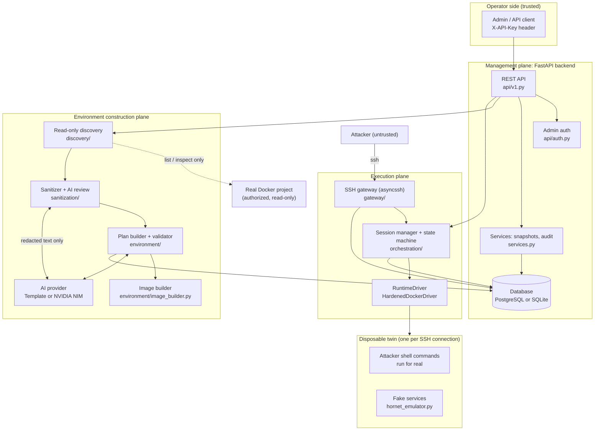

**How to read this diagram.**

- The **operator** talks only to the management API and must present an API key.
- To build an environment, the API calls the **construction plane**: discovery looks at the real Docker project through four read-only calls, the sanitizer removes secrets, the builder turns the clean profile into a plan, and the image builder bakes it into a Docker image. The AI box is optional and only ever receives text that has already been redacted.
- The **attacker** never reaches the API. They connect to the **SSH gateway**, which asks the **session manager** for a twin. The session manager uses a **runtime driver** to start a locked-down container. Commands run inside that container and nothing else.
- Everything (sessions, evidence, events, audit trail) lands in the **database**.
- The dashed line to the real project is the only touch point with production, and it is read-only.

---

## A3. Major components and responsibilities

| Component | Path | Responsibility | Talks to |
|---|---|---|---|
| **Admin API** | `backend/app/api/v1.py`, `schemas.py` | REST endpoints for builds, snapshots, sessions, events, audit, summary. | Auth, services, pipeline, session manager, DB |
| **Admin auth** | `backend/app/api/auth.py` | Checks `X-API-Key`; records the actor for audit. | API |
| **Config** | `backend/app/config.py` | One validated settings object; refuses unsafe values at startup; builds the execution policy. | Everything |
| **Discovery** | `backend/app/discovery/docker_inventory.py` | `ReadOnlyDocker` wrapper (4 read calls) and `collect()`; allowlist check; drops env values at the source. | Docker daemon |
| **Sanitizer** | `backend/app/sanitization/` (`patterns`, `classifier`, `sanitizer`, `ai_review`) | Redacts secrets, emails, IPs, host paths; `assert_clean` as the final gate; optional AI review that can only remove. | Discovery output, AI provider |
| **Environment builder** | `backend/app/environment/` (`builder`, `roles`, `role_detect`, `data_model`, `synthetic_data`, `service_fixtures`, `graph_nodes`) | Deterministic plan from the sanitized profile: files, users, services, DB schema and rows, logs, fixtures. | AI provider (enrichment) |
| **Validator** | `backend/app/environment/validator.py`, `graph.py` | Cross-resource consistency, path normalization, graph invariants, leak scan. | Builder |
| **Image builder** | `backend/app/environment/image_builder.py` | Writes a build context and builds `hornet-twin:<hash>` from the base image. | Docker daemon |
| **Pipeline** | `backend/app/environment/pipeline.py` | Orchestrates discover → sanitize → plan → validate → build image → record draft snapshot, with cleanup on failure. | All of the above |
| **Snapshot services** | `backend/app/services.py`, `immutability.py` | Draft/validate/publish; audit helper; ORM guard that makes published data immutable. | DB |
| **Session manager** | `backend/app/orchestration/session_manager.py`, `lifecycle.py`, `shell_state.py`, `linker.py` | Session limits, state machine, command execution, evidence writing, reaper, reconcile. | Driver, DB |
| **Runtime driver** | `backend/app/runtime/` (`driver`, `docker_driver`, `policy`, `fsdiff`, `factory`) | The `RuntimeDriver` interface and the only implementation, `HardenedDockerDriver`. | Docker daemon |
| **SSH gateway** | `backend/app/gateway/` (`server`, `auth`) | Accepts attacker SSH connections, applies the login policy, one twin per connection, logs gateway events. | Session manager, DB |
| **Twin image** | `twin-image/Dockerfile` | Minimal Debian image: non-root attacker user, setuid bits stripped, `sleep infinity`. | n/a |
| **In-twin emulator** | `twin-image/emulator/hornet_emulator.py` | Fake HTTP, PostgreSQL and Redis servers that answer from fixtures and write events to a file. | Runs inside twin |
| **AI providers** | `backend/app/ai/` | `TemplateProvider` (offline) and `NimProvider` (NVIDIA NIM). Build-time use only today. | NVIDIA NIM over HTTPS |
| **Database** | `backend/app/models.py`, `db.py`, `migrations/` | SQLAlchemy 2 models, JSONB-or-JSON helper, 3 Alembic migrations. | n/a |
| **Demo servers** | `main-server/`, `demo-servers/helpdesk/` | Example "real" Docker projects with planted canary secrets for testing. | n/a |

**Interfaces that exist as real `typing.Protocol`s:** `RuntimeDriver`, `AIProvider`, `ImageBuilder`. `AGENTS.md` also names `Sanitizer` and `EventSink` interfaces; in the code `Sanitizer` is a concrete class and `EventSink` does not exist (events are written straight to the database). **[Gap]**

---

## A4. Data flow

### A4.1 Build-time flow: from a real server to a published snapshot

```mermaid
flowchart LR
    A["Real Docker project<br/>(allowlisted)"] -->|"list, inspect, diff,<br/>network names"| B["Discovery<br/>RawEnvironment<br/>(env VALUES dropped)"]
    B --> C["Deterministic sanitizer<br/>regex rules + entropy"]
    C --> D{"AI review<br/>enabled?"}
    D -- "yes (NIM)" --> E["AI review<br/>remove-only, validated"]
    D -- "no" --> F
    E --> F["assert_clean<br/>final gate"]
    F -->|"SanitizedProfile"| G["Plan builder<br/>users, files, services,<br/>DB schema, logs"]
    G <-->|"optional: schema + documents"| H["AI provider<br/>(validated output)"]
    G --> I["Plan validator"]
    I -->|"ok"| J["Write build context<br/>+ build image"]
    J --> K["Draft snapshot in DB<br/>nodes, service profiles,<br/>twin image digest"]
    K --> L["validate_snapshot"]
    L --> M["publish_snapshot<br/>(explicit admin action)"]
```

**Explanation.**

1. **Discovery** asks Docker for the containers of one project. Environment variable *values* are discarded immediately; only names are kept.
2. The **deterministic sanitizer** replaces secrets, emails, IPs and host paths with placeholders like `<REDACTED:aws_access_key>`.
3. If a real model is configured (NIM), an **AI review** can find additional sensitive text (names, internal hostnames) but may only *remove* text. Its answer is checked by code.
4. **`assert_clean`** is the last word: if any secret-shaped text remains, the build stops.
5. The **builder** is deterministic: the random seed comes from the profile hash, so the same input gives the same output. The AI may optionally propose a database schema and some documents (shell history, notes), and both are validated and rejected if unsafe.
6. The **validator** checks consistency (for example, users in `/etc/passwd` match the plan; credentials agree across files).
7. The image is built and its ID recorded; a **draft snapshot** is written. Nothing is published automatically.
8. An admin calls `validate` then `publish`. Publishing archives the previous published snapshot.

### A4.2 Attack-time flow: from an SSH connection to recorded evidence

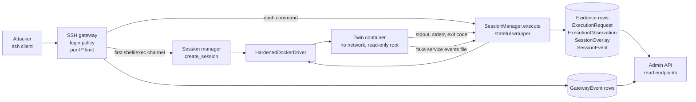

**Explanation.**

- The gateway first records connection and login attempts as **gateway events**. This happens before any twin exists.
- The twin is created **lazily**, when the first shell or exec channel is opened (`Gateway.ensure_session`). A scanner that connects and never logs in costs no container.
- Each command goes through `SessionManager.execute(..., stateful=True)`. The output the attacker sees is the real output of the real command inside the twin.
- After each command the manager takes a filesystem snapshot, diffs it, reads fake-service events, and writes a set of **evidence rows**.
- The admin API can read all of this back. When the SSH connection closes, the twin is destroyed.

---

## A5. Deployment view

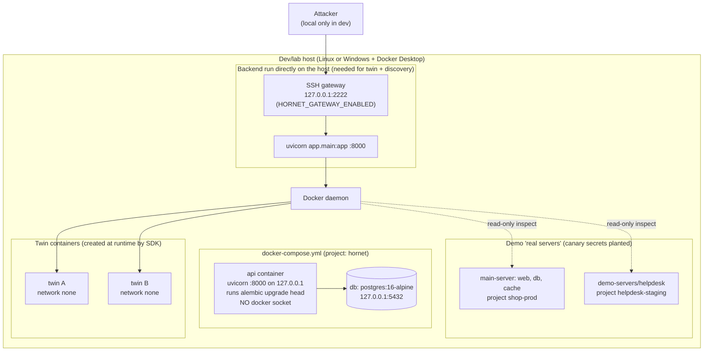

**Explanation.**

- The repo's `docker-compose.yml` starts **only the management plane**: Postgres and the API container, both bound to `127.0.0.1`. Its `api` service deliberately has **no Docker socket**, so inside that container the twin and discovery endpoints answer `503`.
- To use discovery, sessions and the gateway, the backend is run **directly on the host** (the README's quick start: `python -m uvicorn app.main:app`), where it can reach the Docker daemon through the Python SDK. **[Assumption]** This is the intended split between "safe management container" and "feature-complete host process"; the README describes it but it is a notable operational limitation.
- **Twin containers are not in any compose file.** The driver creates them through the Docker SDK, with no network and no mounts.
- The **demo servers** are stand-ins for a real production project. They carry fake canary secrets so tests can prove nothing leaks.
- The gateway binds to `127.0.0.1` by default, and config refuses a non-loopback gateway host unless `HORNET_ENV=prod`.
- A production-style deployment (dedicated VPS, gVisor/Firecracker, egress blocked, `deployment/` directory) is **[Planned]** (Phase 7) and does not exist yet.

---

## A6. Security architecture and trust boundaries

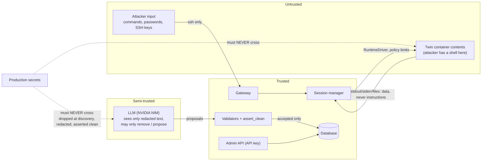

**Explanation.** The picture has three zones.

- **Untrusted**: the attacker and whatever runs inside the twin. Everything that comes out of the twin (output, files, service events) is treated as data to store, never as instructions.
- **Semi-trusted**: the LLM. It only receives already-redacted text, and its replies are only *proposals* that code validates (`doc_validator`, `DataModel.model_validate`, the review's verbatim-removal rules) before they are used.
- **Trusted**: the gateway, session manager, validators and admin API.

The crossed dotted lines show what must **never** happen: production secrets reaching the twin or the model.

**Controls that exist in the code**

| Control | Mechanism | Where |
|---|---|---|
| Read-only discovery | Name-mangled Docker client exposing four read methods; project allowlist (empty by default) | `docker_inventory.py` |
| Secrets stripped at source | Env values never copied out of `inspect` | `docker_inventory.py` (`_service`) |
| Redaction + final gate | 13 regex rules + entropy; `assert_clean` raises `SanitizationFailure` | `sanitization/` |
| AI can only subtract | Verbatim substring removal, length and confidence rules, over-redaction guard (60%) | `sanitization/ai_review.py` |
| Sandboxed execution | `cap_drop ALL`, `no-new-privileges`, read-only root, `network_mode=none`, no mounts, pids/mem/CPU/nofile limits | `runtime/docker_driver.py` |
| Server-side limits | Frozen `ExecutionPolicy` with hard bounds | `runtime/policy.py` |
| Immutable evidence | ORM guard on published snapshots and append-only tables | `immutability.py` |
| Safe startup | Weak admin key, SQLite in prod, out-of-range policy, non-loopback gateway outside prod, bad NIM key/URL all fail startup | `config.py` |
| Gateway restrictions | SFTP/SCP, subsystems, all port forwarding, agent/X11 forwarding refused and logged; per-IP connection cap | `gateway/server.py` |

---

## A7. Key design decisions and trade-offs

| # | Decision | Why | Trade-off / cost |
|---|---|---|---|
| D1 | **Run attacker commands for real** in a disposable container rather than have an LLM imitate a shell. | Output is exact, deterministic and cannot be hallucinated; evidence is genuine. | Real execution means real risk: a container escape is possible. Requires strong isolation (Docker hardening today; gVisor/microVM planned). |
| D2 | **One twin per SSH connection** (not a shared honeypot). | Attackers cannot see or affect each other; reset equals destroy. | More containers and start-up cost; bounded by `max_active_sessions` (default 5). |
| D3 | **Hardened Docker driver first**, behind a `RuntimeDriver` interface. | Works on Windows dev machines and Linux. | Shares the host kernel, so weaker than gVisor/Kata/Firecracker. The code docstring and README say it must not be internet-exposed. Only one driver exists; `runtime_driver` is typed `Literal["docker"]`. |
| D4 | **Deterministic sanitizer always runs first and has the last word**; AI review is optional and remove-only. | A regex layer cannot be talked into leaking; the model can only improve coverage. | Regex cannot catch names or internal hostnames; that is what the optional AI review is for. A model outage in `required` mode fails the build (fail closed). |
| D5 | **Build-time AI only, validated and optional.** `TemplateProvider` gives an offline default. | Keeps the runtime path deterministic and cheap; no latency or cost per command. | The README's "AI fills runtime gaps" idea is not built yet. Uncovered behavior just returns real output (often "command not found"). |
| D6 | **Deterministic builder seeded by the profile hash.** | Same input gives the same snapshot; testable and reproducible. | Every deployment with the same profile gets the same fake data. **[Assumption]** Fingerprinting across deployments is an unaddressed risk. |
| D7 | **Immutable, versioned snapshots** (draft → validated → published → archived). | Investigators can always tell which environment an attacker saw. | Any change needs a new build/version. |
| D8 | **Immutability enforced in the ORM** (`before_flush` listener). | Simple and portable across SQLite and Postgres. | Raw SQL bypasses it. The file itself notes DB triggers as a Phase 7 follow-up. |
| D9 | **Single static admin API key**, constant-time compared. | Smallest thing that works for a capstone. | No RBAC, no per-user attribution (audit actor is always `admin-api-key`), no rotation story. |
| D10 | **Separate evidence tables**: `ExecutionObservation` (raw), `ai_synthesis` (AI), `session_event` (interpretation links), `admin_audit_event`. | Rule 4: never rewrite real output with AI text. | More tables and joins. `ai_synthesis` is currently unused at runtime. |
| D11 | **Stateful shell emulated by wrapping each command** (`cd`, `export`, then a nonce-marked trailer) instead of a persistent process. | Every command becomes a separate recorded, killable request with a clean timeout. | No interactive programs, Ctrl-C does not interrupt a running command, background jobs do not persist across commands. |
| D12 | **Fake services run inside the twin**, not real databases. | Attackers can use `psql`, `redis-cli`, `curl` against believable endpoints without real data. | Only three protocols; the emulator is hand-written; mysql has fixture files but no emulator. |
| D13 | **Gateway accepts after N attempts or on weak passwords; public-key auth always declines.** | Classic honeypot behavior; maximizes captured activity. | Password logging stores attacker-supplied text; controllable with `gateway_log_passwords`. |
| D14 | **JSON column helper** (JSONB on Postgres, JSON elsewhere). | SQLite-based unit tests stay hermetic. | Postgres-only features (indexes on JSON) are not used. |
| D15 | **Lazy twin creation and manager creation.** | The API can start without Docker; scanners cost nothing. | First command pays container start-up. |

---

# Part B: Low-Level Design (LLD)

## B1. Code and module map

```
backend/
├── Dockerfile  alembic.ini
├── migrations/            env.py, versions/0001..0003
├── app/
│   ├── main.py            FastAPI app, lifespan (reaper, gateway)
│   ├── config.py          Settings (pydantic-settings, HORNET_ prefix)
│   ├── db.py              JsonType, Base, engine/sessionmaker
│   ├── models.py          SQLAlchemy models
│   ├── immutability.py    before_flush guard
│   ├── services.py        draft/validate/publish snapshot, audit()
│   ├── schemas.py         Pydantic request/response models
│   ├── graph.py           normalize_path, validate_tree
│   ├── profile.py         Raw* dataclasses, SanitizedProfile
│   ├── api/               auth.py, v1.py
│   ├── discovery/         docker_inventory.py
│   ├── sanitization/      patterns, classifier, sanitizer, ai_review
│   ├── environment/       pipeline, builder, plan, roles, role_detect, data_model,
│   │                      synthetic_data, service_fixtures, graph_nodes, validator, image_builder
│   ├── ai/                provider, nim_provider, enrichment, doc_validator
│   ├── orchestration/     session_manager, lifecycle, shell_state, linker
│   ├── runtime/           driver, docker_driver, policy, fsdiff, factory
│   └── gateway/           server, auth
└── tests/                 flat folder (see B10)
twin-image/                Dockerfile, emulator/hornet_emulator.py
main-server/               demo Flask shop (web, db, cache)
demo-servers/helpdesk/     second demo stack
docker-compose.yml         db + api only
```

**Directories listed in `AGENTS.md` but absent:** `frontend/`, `docs/`, `reports/`, `deployment/`, top-level `gateway/` (the gateway lives in `backend/app/gateway/`), and the modules `observation/` and `telemetry/` (observation is implemented inside the session manager, `fsdiff.py` and `linker.py`; there is no telemetry code).

### B1.1 Key classes and interfaces

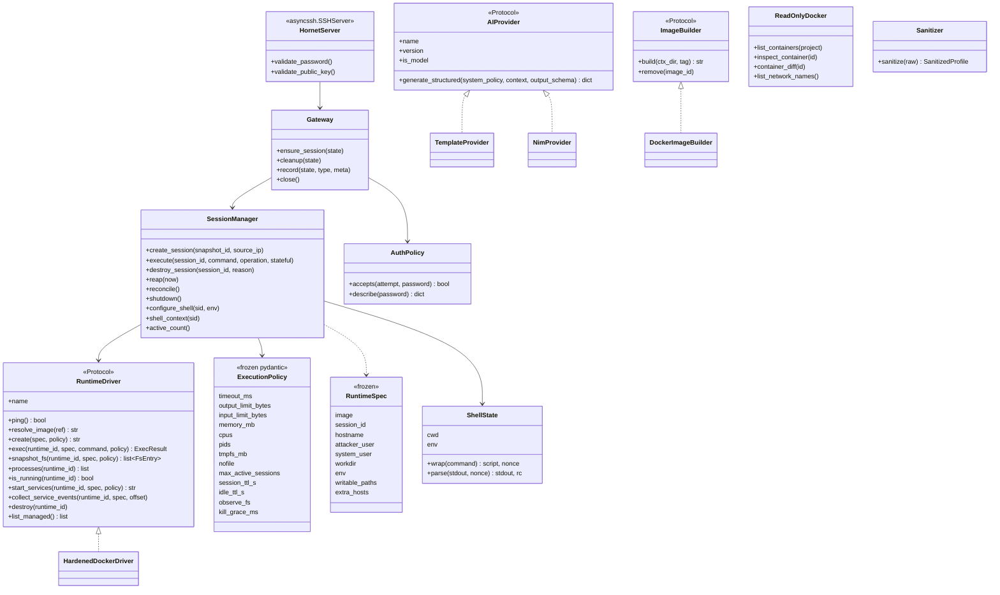

**Explanation.**

- `SessionManager` is the heart of execution. It depends on the `RuntimeDriver` **interface**, never on Docker directly, so tests inject `FakeDriver` and a future gVisor/microVM driver can be dropped in. It also holds an `ExecutionPolicy`, the server-side limits.
- `ShellState` belongs to each live session; it remembers the working directory and exported variables between commands.
- `Gateway` is the SSH-facing layer. `HornetServer` is the asyncssh callback class (password, key, forwarding hooks) and delegates to `Gateway`. `AuthPolicy` decides when a login is accepted.
- `ReadOnlyDocker`, `Sanitizer`, `AIProvider` and `ImageBuilder` are the build-time collaborators. `AIProvider` has two implementations: an offline template provider and the NVIDIA NIM provider.
- `AGENTS.md` mentions a `Sanitizer` *protocol* and an `EventSink` interface; here `Sanitizer` is a plain class and `EventSink` does not exist. **[Gap]**

---

## B2. Database schema

Defined in `backend/app/models.py`; created by migrations `0001_initial_schema` (11 tables), `0002_session_activity_and_end_reason` (adds `last_activity_at`, `end_reason`), `0003_gateway_events` (adds `gateway_event`). All primary keys are UUIDs. JSON columns use `JSONB` on PostgreSQL and `JSON` elsewhere (`db.JsonType`). Status columns are plain strings: there is no DB-level enum or CHECK constraint.

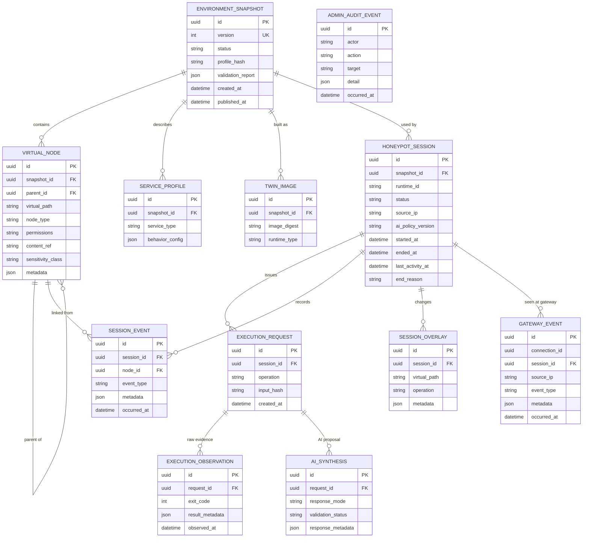

**Explanation (read the diagram top to bottom).**

- An **environment snapshot** is one version of the fake environment. It owns its **virtual nodes** (a tree of files, directories, services, users, databases and endpoints linked by `parent_id`), its **service profiles** (how each fake service behaves) and its **twin image** (the Docker image ID that was built for it).
- A **honeypot session** is one attacker connection on exactly one snapshot. It owns the **execution requests** (one per command), **session events**, **session overlay** rows (what the attacker changed, without ever modifying the snapshot) and links to **gateway events**.
- Each execution request has **execution observation** rows, which are the raw evidence from the container. `ai_synthesis` is the separate place a future AI proposal would be stored; today nothing writes it.
- **`admin_audit_event`** has no relationships on purpose: it records admin actions, never attacker activity. In the schema, `gateway_event.connection_id` is intentionally not a foreign key because a connection can exist before any session does.
- The model gives no FK an `ondelete` action. Deleting is mostly blocked by the immutability rules anyway.

### B2.1 Constraints and indexes worth knowing

| Table | Constraint / index |
|---|---|
| `environment_snapshot` | `version` unique; index on `status` |
| `virtual_node` | `UNIQUE(snapshot_id, virtual_path)`; indexes on `snapshot_id`, `parent_id` |
| `honeypot_session` | index on `snapshot_id`, `started_at` |
| `session_event` | index on `event_type`; composite `ix_session_event_session_time(session_id, occurred_at)` |
| `gateway_event` | indexes on `connection_id`, `source_ip`, `event_type`, `occurred_at`; composite `ix_gateway_event_conn_time(connection_id, occurred_at)` |
| `admin_audit_event` | indexes on `action`, `occurred_at` |

### B2.2 Immutability rules (`backend/app/immutability.py`)

Registered once as a SQLAlchemy `before_flush` listener on the `Session` class, so every session is covered.

| Rule | Behavior |
|---|---|
| Locked statuses | `published`, `archived` |
| Snapshot rows | A locked snapshot cannot be deleted or modified. The only allowed change is `status: published → archived`. |
| Snapshot children | `VirtualNode`, `ServiceProfile`, `TwinImage` of a locked snapshot cannot be inserted, changed or deleted. |
| Append-only tables | `SessionEvent`, `AdminAuditEvent`, `ExecutionObservation`, `AiSynthesis`, `GatewayEvent` can be inserted, never updated or deleted. |
| Not guarded | `HoneypotSession`, `ExecutionRequest`, `SessionOverlay` remain mutable. |
| Failure | Raises `ImmutableError`. **[Gap]** It has no HTTP mapping in `api/v1.py`, so an API path that triggered it would return a 500. |
| Limit | ORM-only. Raw SQL/Core statements bypass it; PostgreSQL triggers are listed as Phase 7 follow-up. |

---

## B3. REST API reference

Base prefix: `/api/v1`. OpenAPI docs: `http://127.0.0.1:8000/docs` when the app is running. All routes except `/health` are in the `admin` router, which requires `X-API-Key`.

| Method | Path | Purpose | Body / query | Success | Error cases |
|---|---|---|---|---|---|
| GET | `/health` | Liveness: DB check, runtime status, gateway status | none | `{status, database, runtime, gateway}` | 503 if `SELECT 1` fails |
| POST | `/environments/build` | Build a draft snapshot | `BuildRequest{source: "seed"\|"docker", project?, nodes?}` | 201 `SnapshotOut` | `docker`: 422 missing project, 403 not allowlisted, 503 Docker unavailable, 422 `DiscoveryError`/`BuildFailed{stage,message,errors}`. `seed`: 422 on bad paths |
| POST | `/discovery/preview` | Show the sanitized profile; builds nothing | `{project}` | sanitized profile dict | 403 / 503 / 422; sanitization failure audited as `security.sanitization_failed` |
| GET | `/environments` | List snapshots (newest version first, **not paginated**) | none | `list[SnapshotOut]` | n/a |
| GET | `/environments/{id}` | One snapshot | n/a | `SnapshotOut` | 404 |
| POST | `/environments/{id}/validate` | Run graph validation | n/a | `SnapshotOut` | 404, 409 |
| POST | `/environments/{id}/publish` | Publish (must be validated) | n/a | `SnapshotOut` | 404, 409 |
| GET | `/environments/{id}/tree` | Nodes ordered by path | n/a | `TreeOut` | 404 |
| GET | `/sessions` | List sessions | `limit`, `offset` | `Page[SessionOut]` | n/a |
| GET | `/sessions/{id}` | One session | n/a | `SessionOut` | 404 |
| GET | `/sessions/{id}/events` | Session event timeline | `limit`, `offset` | `Page[EventOut]` | 404 |
| POST | `/sessions` | Create a twin (admin path) | `{snapshot_id?}` (defaults to published) | 201 `SessionOut` | 409 `SnapshotNotPublished`, 429 `SessionLimitReached`, 409 `ImageMismatch`, 503 runtime |
| POST | `/sessions/{id}/exec` | Run a command (admin test console) | `{command: 1..65536 chars}` | `ExecOut` (`source: "execution"`) | 404, 409 not usable, 422 rejected input. **Not audited.** |
| DELETE | `/sessions/{id}` | Destroy a session | n/a | `SessionOut` | 404 |
| GET | `/gateway/events` | Gateway events | `event_type`, `source_ip`, `limit`, `offset` | `Page[GatewayEventOut]` | n/a |
| GET | `/analytics/overview` | Counts: snapshots by status, sessions, active sessions, events by type, published version | n/a | `OverviewOut` | n/a |
| GET | `/audit` | Admin audit log | `limit`, `offset` | `Page[AuditOut]` | n/a |

**Pagination.** `limit` defaults to 50, max 200 (`page_size_default`, `page_size_max`).

**Rendering warning.** `EventOut.metadata` and `GatewayEventOut.metadata` contain attacker-supplied text (the code comment in `schemas.py` says so). Any UI must escape it. No UI exists yet.

**Planned but absent:** an authenticated WebSocket live feed (README / Phase 6).

**Session-error to HTTP mapping** (`_SESSION_ERRORS` in `api/v1.py`):

| Exception | HTTP |
|---|---|
| `SnapshotNotPublished` | 409 |
| `SessionLimitReached` | 429 |
| `SessionNotFound` | 404 |
| `SessionNotUsable` | 409 |
| `InputRejected` | 422 |
| `ImageMismatch` | 409 |
| `RuntimeUnavailable` | 503 |

---

## B4. Authentication and authorization

### B4.1 Admin API

- **Mechanism:** a single shared secret in the `X-API-Key` header, checked by `require_admin` (`api/auth.py`) with `secrets.compare_digest` (constant-time).
- **Failure:** `401 "invalid or missing API key"` (no `WWW-Authenticate` header).
- **Scope:** the dependency is attached to the whole `admin` router, so every route except `/health` needs it. Some handlers also receive the actor string (`"admin-api-key"`) for audit.
- **Startup rules:** the key has no default; it must be at least 16 characters and not a known placeholder (`change-me`, `admin`, `password`, ...).
- **Not present:** users, roles, JWT, sessions, key rotation. `AGENTS.md` mentions "RBAC for admin only"; with one role this is trivially true. **[Gap]**
- **Consequence:** all audit entries share one actor, so actions cannot be attributed to people.

### B4.2 Attacker-facing SSH gateway

The gateway is *intentionally* permissive; it is the bait. `gateway/auth.py` and `gateway/server.py`:

| Aspect | Behavior |
|---|---|
| Password login | `AuthPolicy.accepts(attempt, password)` returns true if the password is in the weak list (`123456,password,admin,root,toor` by default) **or** the attempt number is at least `gateway_accept_after` (default 3). |
| Attempt cap | After 6 failed attempts the connection is closed. |
| Public-key login | Always declined, but the fingerprint is logged (`auth.publickey`). |
| Username | Cosmetic; stored (truncated to 64 chars). The shell is always uid 1000 `user`. |
| Password storage | `gateway_log_passwords` true: first 128 chars stored. False: only length and a 16-hex-char SHA-256 prefix. |
| Per-IP cap | `gateway_max_connections_per_ip` (default 3); excess connections are logged as `limit.rejected` and closed. |
| Refused features | SFTP/SCP/subsystems, direct and remote TCP forwarding, UNIX forwarding, agent and X11 forwarding. Each is logged (`forward.denied`, `subsystem.denied`). |
| Host key | Created on first start (ed25519, mode 0600) and reused so the fingerprint is stable. |
| Banner | `server_version` defaults to `OpenSSH_9.2p1 Debian-2+deb12u3` (spoofed; the handshake is asyncssh). |
| Idle | Interactive reads time out at `idle_ttl_s` (default 300 s) with an "auto-logout" message. |

---

## B5. Configuration and execution policy

`Settings` in `backend/app/config.py`: `pydantic-settings`, prefix `HORNET_`, reads `.env` (`utf-8-sig`), ignores unknown keys. `get_settings()` is cached. `create_app()` calls it at import time, so a bad config stops the process.

### B5.1 Settings

| Group | Setting (default) |
|---|---|
| Core | `env` (`dev`), `database_url` (`sqlite:///./hornet_dev.db`), `admin_api_key` (**required**), `page_size_default` (50), `page_size_max` (200) |
| Twin / runtime | `runtime_driver` (`docker`), `twin_base_image` (`hornet-twin-base:2`), `twin_timeout_ms` (5000), `twin_output_limit_bytes` (65536), `twin_memory_mb` (128), `twin_cpus` (0.5), `twin_pids` (64), `twin_tmpfs_mb` (16), `max_active_sessions` (5), `session_ttl_s` (900), `idle_ttl_s` (300) |
| Discovery | `discovery_allowed_projects` (empty = nothing allowed), `build_dir` (`./data/builds`) |
| AI | `ai_provider` (`template`), `nvidia_api_key` (secret), `nim_base_url` (`https://integrate.api.nvidia.com/v1`), `nim_model`, `nim_timeout_s` (90), `nim_max_tokens` (4096), `ai_sanitizer_mode` (`required`; effective only when provider is `nim`) |
| Gateway | `gateway_enabled` (false), `gateway_host` (`127.0.0.1`), `gateway_port` (2222), `gateway_host_key_path`, `gateway_server_version`, `gateway_accept_after` (3), `gateway_weak_passwords`, `gateway_log_passwords` (true), `gateway_max_connections_per_ip` (3), `gateway_login_timeout_s` (30) |

### B5.2 Startup rejections ("unsafe defaults must fail startup")

1. Admin key missing, shorter than 16 characters, or a known placeholder.
2. `env=prod` with a SQLite database.
3. Any execution-policy value outside its hard bounds (table below).
4. Gateway enabled on a non-loopback host when `env` is not `prod`.
5. `ai_provider=nim` without a key of at least 10 characters, or with a non-HTTPS URL (plain HTTP only for `localhost` / `127.0.0.1`).

### B5.3 Execution policy hard bounds (`runtime/policy.py`)

| Field | Default | Allowed range |
|---|---|---|
| `timeout_ms` | 5000 | 100 – 60000 |
| `output_limit_bytes` | 65536 | 1024 – 1048576 |
| `input_limit_bytes` | 8192 | 16 – 65536 |
| `memory_mb` | 128 | 16 – 1024 |
| `cpus` | 0.5 | > 0 – 2 |
| `pids` | 64 | 8 – 512 |
| `tmpfs_mb` | 16 | 1 – 256 |
| `nofile` | 256 | 32 – 4096 |
| `max_active_sessions` | 5 | 1 – 100 |
| `session_ttl_s` | 900 | 10 – 86400 |
| `idle_ttl_s` | 300 | 5 – 86400 |
| `kill_grace_ms` | 3000 | 500 – 30000 |
| `observe_fs` | true | boolean |

`input_limit_bytes`, `nofile`, `observe_fs` and `kill_grace_ms` are not wired to settings; they use the defaults above. The attacker can never change any of these values: the policy object is frozen and built only from server settings (rule 7).

---

## B6. Detailed workflows

### B6.1 Environment build pipeline

Code: `environment/pipeline.py::build_from_docker`, called by `POST /environments/build` with `source="docker"`.

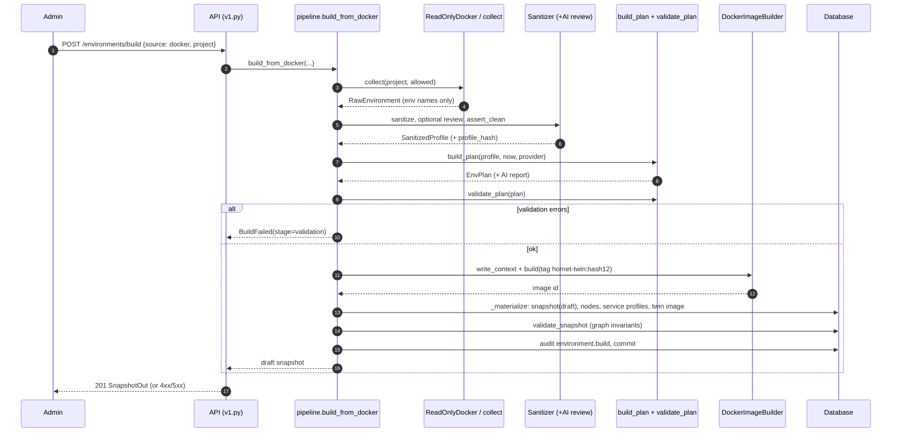

**Explanation.** The pipeline is a straight line with an early exit at each stage.

- Each completed stage name (`sanitized`, `planned`, `validated`, `image_built`) is appended to `report["stages"]`, so a failure tells you how far it got.
- A failure at any point raises `BuildFailed(stage, message, report)`.
- `_abort` then rolls back the database, **removes the half-built image**, and writes an audit event (`environment.build_failed`, plus a louder `security.sanitization_failed` when the stage was sanitization).
- The currently published snapshot is never touched, and a build never publishes.

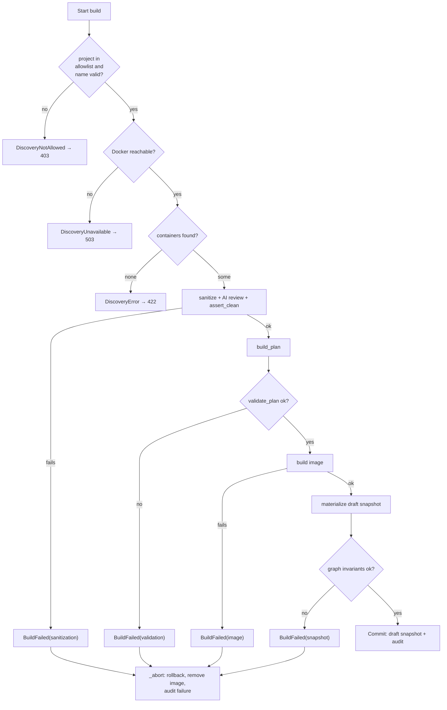

**Explanation.** This is the same flow viewed as a decision tree: every "no" branch ends in a typed error (a specific HTTP status or a named `BuildFailed` stage) and the same cleanup. Discovery limits: at most `MAX_SERVICES = 50` services per project, and containers carrying the label `com.hornet.managed` (Hornet's own twins) are skipped.

**What `build_plan` produces** (deterministic, seeded by `int(profile_hash[:16], 16)`):

- Base users, `/etc/passwd`, `/etc/group` and `/etc/motd`.
- Per-role files from `ROLE_BUILDERS`: `postgres`, `mysql`, `redis`, `nginx`, `http-app`, `generic`. Role is detected from the image, ports and command by `role_detect.detect_role`, not from a hard-coded server (rule 11).
- A synthetic database model (`data_model.pick_model`) *only if* a database or HTTP app role exists. The AI may propose the schema (validated by `DataModel.model_validate`); on failure a keyword-based default is used.
- `/usr/share/hornet/services.json` fixture file for the in-twin emulator.
- Optional AI documents (`.bash_history`, `NOTES.txt` style) after validation by `doc_validator`.
- Size limits: 64 KB per file, 4 MB total, 2000 files.

Only `postgres`, `redis`, `http-app` and `nginx` roles get an emulator. `mysql` gets files only.

### B6.2 Sanitization pipeline

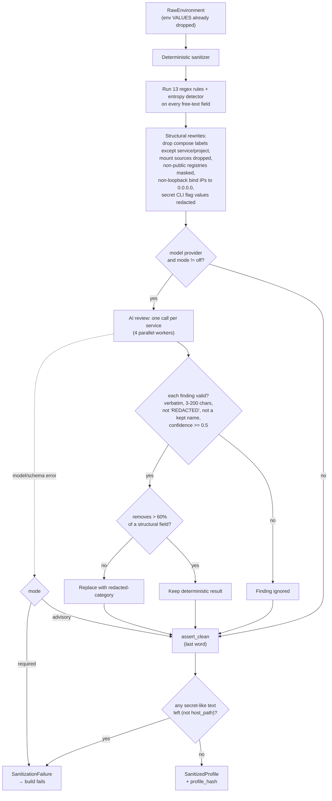

**Explanation.**

1. The **regex layer** is deterministic and runs first. Rules include private keys, AWS/Stripe/GitHub/Slack tokens, JWTs, URL credentials, bearer tokens, `key=value` secrets, secret CLI flags (`--password x`, `curl -u user:pw`), emails, IPv4 (except `127.0.0.1`, `0.0.0.0`) and host paths. A Shannon-entropy check (token ≥ 32 chars, entropy ≥ 3.8) catches unknown formats.
2. The **AI review** sees only already-redacted fields plus the environment *variable names* and the names it must keep. It returns "findings"; code accepts a finding only if the text really appears in what was sent and passes the length, confidence and keep-name rules. It can also raise an env variable's class from `config` to `secret`, never lower it.
3. **`assert_clean`** re-scans everything (including dictionary keys and joined lists, since a secret can span list items). It is the last word: if the AI step failed in `required` mode, or any secret survives, the build stops.
4. Result: a `SanitizedProfile` with a `profile_hash` (SHA-256 of the sorted JSON) that seeds the deterministic builder.

**Limits (README says so too):** the regex layer cannot catch names or internal hostnames.

### B6.3 Snapshot lifecycle

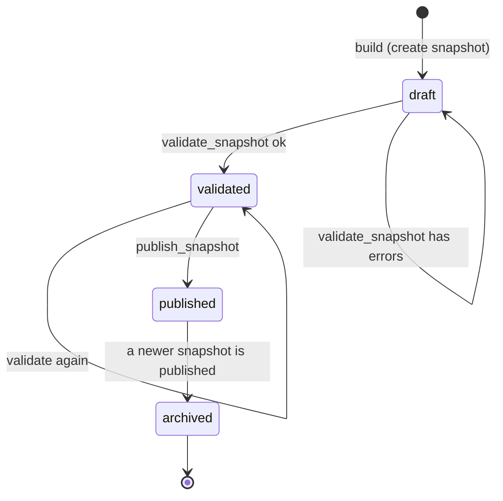

**Explanation.**

- A new snapshot is `draft`. `validate_snapshot` (allowed only from `draft` or `validated`) runs the graph checks. With no errors it becomes `validated`; otherwise it stays `draft` and the errors are saved in `validation_report`.
- `publish_snapshot` requires `validated`. In one database transaction it archives every currently published snapshot and then publishes the new one. The immutability guard allows exactly that `published → archived` change.
- Once `published` or `archived`, the snapshot and its nodes, service profiles and image rows cannot change. The enum also defines `rejected`, but no code path sets it. **[Gap]**
- Sessions can only be created on a `published` snapshot.

### B6.4 Session lifecycle (state machine)

Code: `orchestration/lifecycle.py`. `check(current, new)` raises `IllegalTransition` for anything not listed.

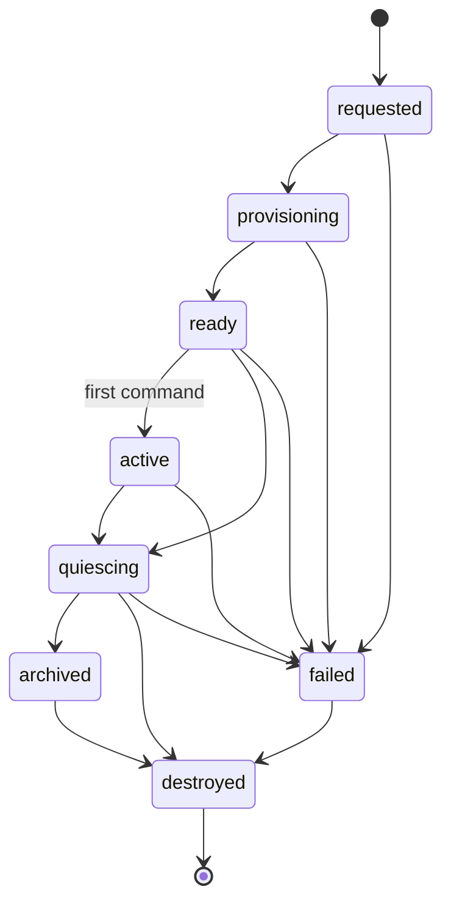

**Explanation.** A session is `requested`, then `provisioning` while the container starts, then `ready`. The first command moves it to `active`. Normal end is `quiescing` (winding down) then `destroyed`. Any problem (runtime lost, limit exceeded, observer failed, provisioning error) goes to `failed`, then `destroyed`.

**Note:** `archived` is a legal state in the table but the session manager never enters it: `destroy_session` goes `quiescing → destroyed`. `LIVE = {provisioning, ready, active}` is the set that counts against the session limit. **[Gap]**

### B6.5 Creating a session

Code: `SessionManager.create_session` (`session_manager.py`).

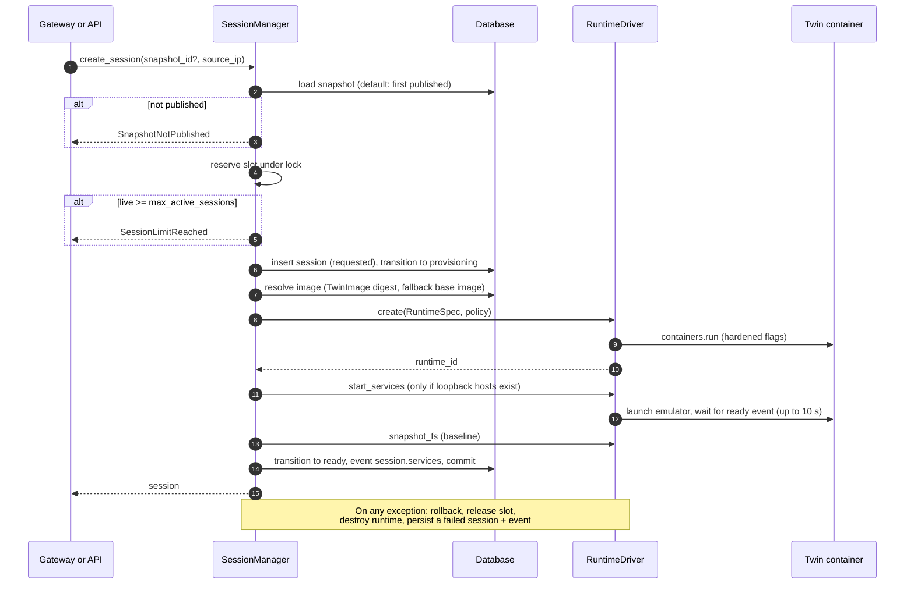

**Explanation.**

- The manager **reserves a slot before doing slow work**, so two simultaneous requests cannot both exceed the limit.
- The image comes from the snapshot's `TwinImage` row. If the ID the driver reports does not match, the session is refused (`ImageMismatch`). If there is no `TwinImage` row, the base image is used as a fallback (a leftover from earlier phases, per the code comments).
- Service names from each `ServiceProfile` are mapped to loopback IPs and passed as `extra_hosts`, so inside the twin `db` or `cache` resolve locally to the emulator.
- The hostname is random (`srv-<hex6>`) per session.
- The **baseline filesystem snapshot** is what later diffs are compared against.
- On failure, a `failed` session row plus a `session.failed` event is still written, so failures are visible.

### B6.6 Executing a command

Code: `SessionManager.execute`.

```mermaid
sequenceDiagram
    autonumber
    participant Caller as Gateway or API
    participant SM as SessionManager
    participant Shell as ShellState
    participant Drv as HardenedDockerDriver
    participant Tw as Twin
    participant DB as Database

    Caller->>SM: execute(sid, command, operation, stateful)
    SM->>SM: check size (1..input_limit_bytes) and no NUL
    SM->>SM: find live session; take per-session lock
    SM->>DB: status must be ready/active; ready becomes active
    SM->>DB: add ExecutionRequest (sha256 of input, not the text)
    SM->>Shell: wrap(command) when stateful
    SM->>Drv: exec(script)
    Drv->>Tw: timeout -s KILL N bash -c script (as attacker uid)
    Tw-->>Drv: stdout/stderr (capped), exit code
    Drv-->>SM: ExecResult
    SM->>Shell: parse(stdout, nonce): restore cwd/env/exit code
    alt runtime_killed
        SM->>DB: fail session ("runtime killed")
    else
        SM->>Drv: processes() (docker top on host)
        alt process table full or fork failed
            SM->>DB: fail session ("process limit")
        else observe_fs
            SM->>Drv: snapshot_fs, diff against previous
        end
    end
    SM->>DB: ExecutionObservation (raw, source=execution)
    SM->>DB: SessionOverlay per file change
    SM->>DB: SessionEvent: resource_access, fs_change, service.*, command_executed
    SM-->>Caller: ExecOutcome
```

**Explanation.**

1. **Validate input** (size and NUL byte). Reject with `InputRejected`.
2. **One command at a time per session**, via a lock. This keeps filesystem diffs and ordering correct.
3. **Record the request first.** The row stores only the SHA-256 of the command; the attacker's raw text is carried in `command_executed` events and gateway data. **[Assumption]** I did not trace where the raw command text is persisted for later review beyond the evidence in `result_metadata`; confirm this is intended.
4. **Stateful wrapper** (`ShellState.wrap`) prepends `cd -- <cwd>` and `export` lines and appends a trailer that prints a marker containing a **random per-command nonce**, the return code, `$PWD` and `env -0`. `parse` strips it from stdout so the attacker sees clean output, and updates state. The nonce prevents an attacker from forging the marker. Caps: 100 variables, 4096 bytes per value, 16 KB total environment, 1024-byte cwd.
5. **Failure handling** after the command: runtime killed, process table exhausted (fork bomb: exit code 125 with "fork" in stderr, or process count ≥ `pids - 1`), or observer failure all fail the session and destroy the container.
6. **Evidence** is written as separate rows: raw observation, overlay changes (the base graph is never modified), and events with a `basis` field (`command-argument`, `filesystem-diff`) so interpretation is distinguishable from proof. `linker.touched_paths` resolves command arguments to snapshot node paths (≤ 200 tokens, ≤ 20 links) and is documented as observation, not proof.
7. Caps on events per command: 50 `fs_change`, 200 service events (plus a `service.overflow` event).

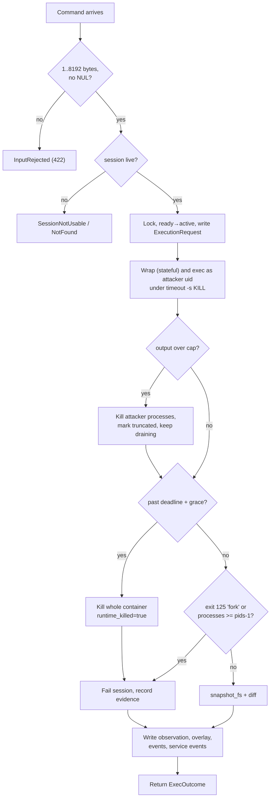

**Explanation.** Three safety nets protect the host from a misbehaving command: the in-container `timeout -s KILL`, the output cap (which kills the attacker's processes), and a host-side deadline that kills the entire container if even that did not return. Every path, including the failure ones, still writes evidence.

### B6.7 SSH gateway connection

Code: `gateway/server.py`.

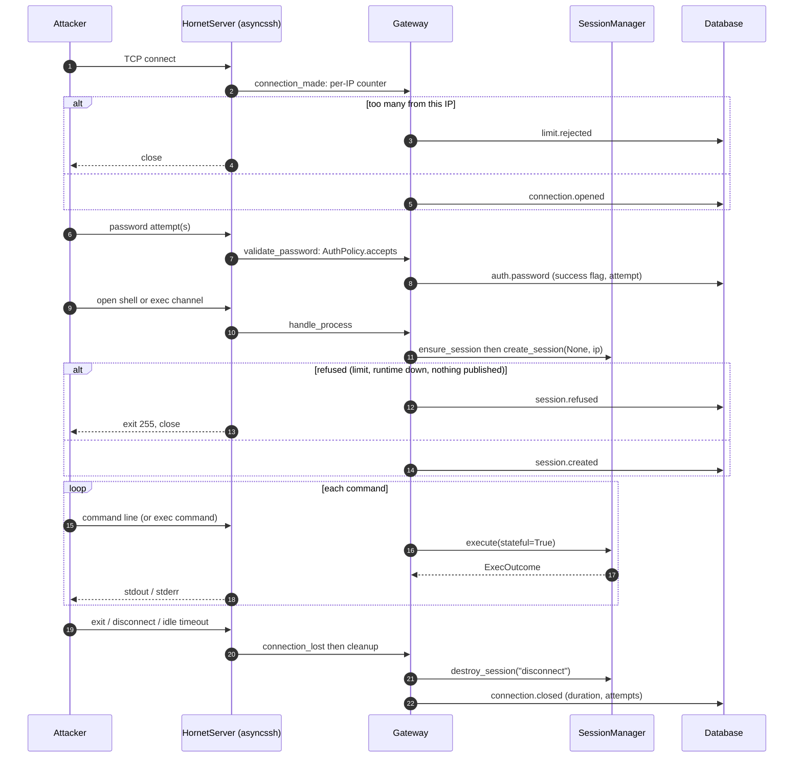

**Explanation.**

- **Exec mode** (`ssh host cmd`): one command, then exit with the command's exit code.
- **Shell mode:** reads lines in a loop. With a PTY it prints the MOTD (the result of `cat /etc/motd`), a fake "Last login" line and a prompt like `user@srv-ab12cd:~$`.
- `exit` / `logout`, EOF or idle timeout end the loop.
- If a limit is exceeded and the twin is killed, the connection is closed.
- Attacker-facing errors are generic. The module's docstring states it never shows internal errors to attackers. Losing an event write never breaks a connection.
- **On shutdown**, `Gateway.close` stops listening, closes every connection and waits (up to 60 s) for each twin's cleanup.

### B6.8 Reaper and restart reconciliation

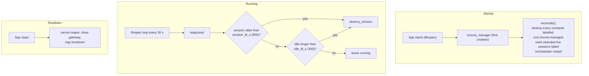

**Explanation.** Sessions live in memory (`_live`) as well as in the database, so a process restart would orphan containers. `reconcile()` therefore removes all Hornet-labelled containers and fails the stranded session rows. The reaper enforces the maximum session age and idle time. A restart destroys all sessions (README limit).

### B6.9 AI provider call

Code: `ai/nim_provider.py`, `ai/provider.py`, `ai/enrichment.py`, `ai/doc_validator.py`.

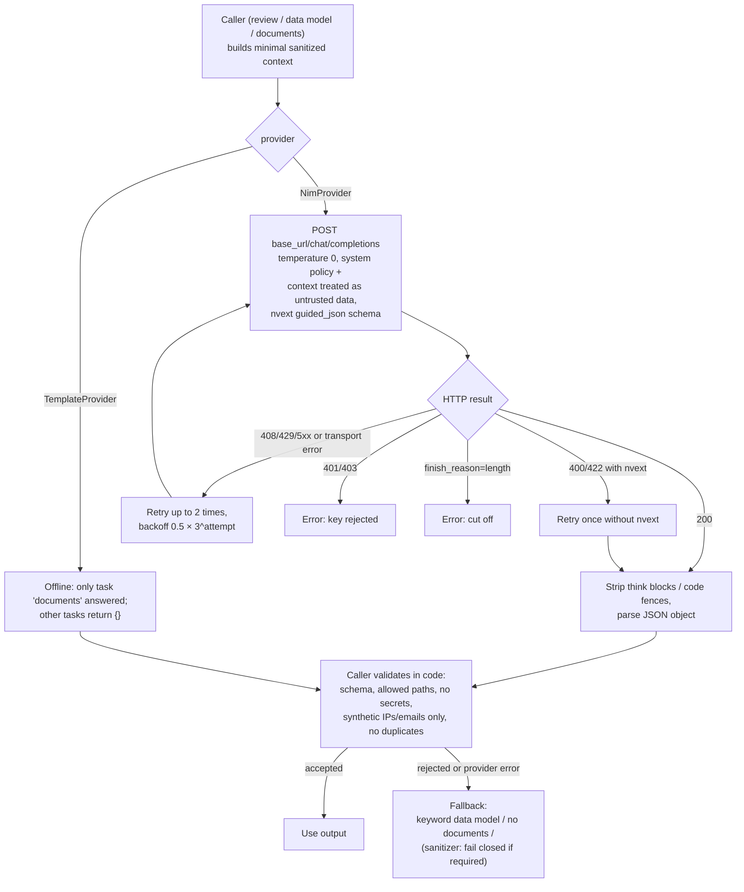

**Explanation.**

- Today the AI is called at **build time only**, for three tasks: sanitization review, database-schema proposal and document enrichment.
- **Prompts and replies are never logged.** Error messages never include model content, and the API key is hidden from the provider's `repr`.
- `doc_validator` accepts at most 12 documents, only under `/home/user/`, `/opt/`, `/srv/`, `/var/www/`, `/var/log/`, never over protected paths (`/etc/passwd`, `/etc/shadow`, `/etc/sudoers`, `/usr/share/hornet`, ...), at most 64 KB, no secret-like text, only synthetic IPs and the planned people's emails. Rejection reasons never contain the content.
- `enrich` swallows any provider exception (recording only the exception type) so **an AI problem can never fail a build**, except the sanitizer review in `required` mode which deliberately fails closed.
- **There is no runtime router** (real execution → fixture → AI). The Phase 5 behavior in the README is not implemented. The emulator emits `unsupported` events that a future AI layer could use.

---

## B7. Runtime hardening details

### B7.1 Twin container creation flags (`runtime/docker_driver.py`, `containers.run`)

| Category | Setting |
|---|---|
| Command | `["sleep", "infinity"]`, name `hornet-twin-<session12>`, `detach=True`, `init=True` |
| Identity | PID 1 runs as `1001:1001` (system user); attacker commands run as `1000:1000` (`user`). The attacker cannot kill or read PID 1. |
| Network | `network_mode="none"`; `extra_hosts` only maps fake-service names to loopback aliases |
| Privilege | `cap_drop=["ALL"]`, `security_opt=["no-new-privileges:true"]`, `privileged=False`. Seccomp is Docker's default profile (not explicitly set). |
| Filesystem | `read_only=True`; tmpfs for `/tmp`, `/var/tmp`, `/home/user` (`rw,nosuid,nodev,size=<tmpfs_mb>m`, `mode=1777`); `/run/hornet` tmpfs 4 MB, owned by the system user, mode 0700, `noexec` |
| Resources | `mem_limit` = `memswap_limit` (no swap), `nano_cpus`, `pids_limit`, `ulimits nofile` |
| Logging / labels | log driver `none`; labels `com.hornet.managed=true`, `com.hornet.session_id` |
| Not present | Mounts, Docker socket, host network |
| Seeding | Files destined for the tmpfs paths are shipped in `/usr/share/hornet/seed/<path>` in the image and copied into the tmpfs at start, as the attacker user |

**Twin image (`twin-image/Dockerfile`):** `debian:bookworm-slim` with common tools (bash, coreutils, procps, curl, wget, openssh-client, python3, postgresql-client, redis-tools); all setuid/setgid bits stripped; PID 1 is the system account (uid 1001 `hornet-sys`), the attacker account is `user` (uid 1000), and the image ends with `CMD sleep infinity`.

### B7.2 Execution details

- Command wrapper: `/usr/bin/timeout -s KILL <seconds> /bin/bash -c <script>` as the attacker user.
- Output is streamed in a thread and capped at `output_limit_bytes`; on overflow the driver runs `kill -KILL -1` as the attacker user and keeps draining.
- If the host-side deadline (`timeout + kill_grace_ms`) passes, the whole container is killed and `ExecResult(runtime_killed=True)` is returned.
- `timed_out` is inferred as exit code 137 and duration ≥ 90% of the timeout.
- `snapshot_fs`: `find <writable_paths> -printf '%y\t%s\t%T@\t%p\0'`, capped at 1 MiB, parsed by `fsdiff.parse_find`; `fsdiff.diff` returns created/modified/deleted and ignores directory size and mtime noise.
- `processes`: `docker top` from the host, capped at 100 rows, so it works even when the twin cannot fork.
- `destroy`: `remove(force=True, v=True)`, idempotent.
- `list_managed`: lists containers by label for reconciliation.

### B7.3 In-twin fake services

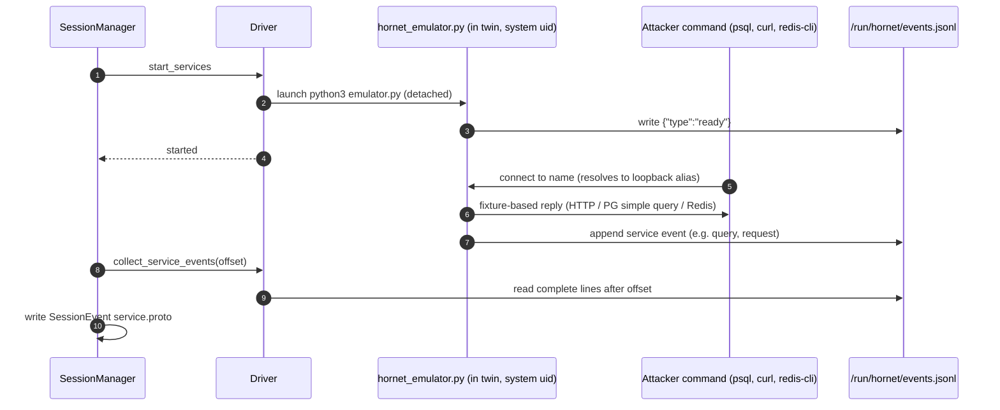

**Explanation.** The emulator is a small Python program that runs inside the twin as the system user and answers from `services.json` (generated at build time). The attacker's user cannot read or stop it (`/run/hornet` is mode 0700 owned by the system user). Each interaction is appended to an events file; after each command the manager reads new complete lines by byte offset and turns them into `service.*` session events. Unsupported statements are flagged as events (the hook for a future AI layer).

---

## B8. Event model

Three separate streams, matching `AGENTS.md` ("admin audit events and attacker session events go to separate tables").

| Stream | Table | Written by | Event types seen in the code |
|---|---|---|---|
| Gateway (before/around sessions) | `gateway_event` | `Gateway.record` | `connection.opened`, `connection.closed`, `limit.rejected`, `auth.password`, `auth.publickey`, `session.created`, `session.refused`, `forward.denied`, `subsystem.denied` |
| Attacker session | `session_event` | `SessionManager` | `session.<status>` (each transition), `session.services`, `session.failed`, `command_executed`, `resource_access`, `fs_change`, `service.<proto>`, `service.overflow` |
| Admin audit | `admin_audit_event` | `services.audit` | `environment.build`, `environment.build_failed`, `security.sanitization_failed`, `environment.validate`, `environment.publish`, `discovery.preview`, `session.create`, `session.destroy` |

**Raw evidence vs interpretation**

| Kind | Table | Nature |
|---|---|---|
| Raw execution evidence | `execution_request` + `execution_observation` (`source: "execution"`) | What really happened in the container. Never produced by AI. |
| Filesystem changes | `session_overlay` | Overlay of changes per session; the base graph is never mutated. |
| Graph links | `session_event.node_id` with `meta.basis` | Observations linking commands/changes to nodes; explicitly not proof. |
| AI proposals | `ai_synthesis` | Reserved for runtime AI; **unused today**. |

All event tables listed as append-only are protected by the ORM guard.

---

## B9. Error handling and failure modes

| Situation | Behavior | Where |
|---|---|---|
| Bad admin key | 401 | `api/auth.py` |
| Unsafe configuration | Process fails at startup | `config.py` |
| Project not allowlisted / bad name | 403 | `discovery` |
| Docker daemon unreachable | 503 (`docker unavailable` / `twin runtime unavailable`); API itself keeps running | `v1.py` dependencies |
| Sanitization failure | Build aborted, audited loudly | `pipeline._abort` |
| Validation / image / snapshot failure | Build aborted, rollback, image removed, audit; published snapshot untouched | `pipeline` |
| AI error | Ignored for enrichment; fails closed only in sanitizer `required` mode | `enrichment`, `ai_review` |
| Session limit | `SessionLimitReached` → 429 (API) or `session.refused` + close (gateway) | `session_manager`, `gateway` |
| Illegal state change | `IllegalTransition` | `lifecycle.py` |
| Attacker input too large / NUL | `InputRejected` → 422 (API), "command too long" (gateway) | `execute` |
| Timeout | Exit 137, `timed_out=true`, session continues | driver |
| Output flood | Truncated, processes killed, `truncated=true` | driver |
| Fork bomb / process exhaustion | Session `failed` ("process limit"), container destroyed | `_exhausted` |
| Container wedged / deadline passed | Container killed, session failed, gateway connection closed | driver, `_run` |
| Observer failure | Session failed ("observer failed") | `execute` |
| Orchestrator restart | `reconcile()` removes labelled containers, fails stranded sessions | `reconcile` |
| Event write failure at gateway | Logged, connection continues | `Gateway.record` |
| Service-event ingest failure | Ignored; never breaks a command | `execute` |
| `ImmutableError` | Currently unmapped (500). **[Gap]** | `immutability.py` |

**General pattern.** Typed exceptions are translated per route into `HTTPException` (`from None`). There is no global exception handler, CORS or middleware.

---

## B10. Testing strategy

The `tests/` folder is flat. `AGENTS.md` describes `unit/`, `integration/`, `isolation/` and `ai_consistency/` subfolders; in practice the categories are expressed by file names and a `docker` pytest marker.

| Category | Files | What it proves |
|---|---|---|
| Sanitizer | `test_sanitization.py` | Every rule detects its kind, benign text is not flagged, redaction is idempotent, a planted canary never survives, discovery is read-only and rejects `../etc` and similar project names |
| Graph & immutability | `test_graph.py`, `test_immutability.py` | Path normalization, tree invariants, published snapshots frozen, publish archives the old one, append-only tables |
| Session manager (fake driver) | `test_session_manager.py`, `test_stateful_shell.py`, `test_fsdiff.py` | Lifecycle, limits and slot release, rejected input, timeouts, process exhaustion, TTL/idle reap, reconcile, shell-state forgery resistance, bounded linker |
| Environment & AI safety | `test_environment.py`, `test_nim_and_ai_review.py` | Determinism, consistency, adversarial AI documents rejected, bad providers never fail a build, review can only remove, retries and fallbacks |
| Generic shapes (rule 11) | `test_generic_shapes.py` | Nine very different server shapes all build valid, leak-free environments |
| API, gateway, emulator | `test_api.py`, `test_gateway.py`, `test_emulator.py` | Auth, endpoints, startup rejections, login policy, per-connection twins, wire-protocol behavior |
| Real Docker (marker `docker`) | `test_docker_isolation.py`, `test_docker_build.py`, `test_docker_gateway.py` | No network, no socket, read-only root, no caps, timeout/flood/fork-bomb/memory limits, session isolation, cleanup; real builds across several compose stacks |

**Fakes over mocks:** `conftest.py` makes the suite hermetic (in-memory SQLite, template provider, no key); `fakes.py` has `FakeDriver`; `helpers_discovery.py` has `FakeReadOnlyDocker` and `FakeImageBuilder`. Docker tests are skipped if the daemon or `hornet-twin-base:2` is missing.

**Not present:** a `FakeProvider` with canned adversarial runtime outputs, because the runtime AI path does not exist yet. CI configuration (Windows + Linux matrix) is absent from the repository. **[Gap]**

---

## B11. Observability and logging

| Aspect | State |
|---|---|
| Structured JSON logs | **[Planned]** (`AGENTS.md`). The code uses the standard `logging` module (`hornet.gateway`) without a JSON formatter configured. |
| Metrics / tracing (`telemetry/`) | Does not exist. |
| Health | `GET /api/v1/health` (DB, runtime, gateway). |
| Prompt/response logging | Deliberately none. |
| Container logs | Disabled for twins (`log_config=NONE`). |
| Data retention policy | **[Planned]** (Phase 7). |

---

# Part C: Assumptions, gaps and risks

### C1. Implemented vs planned (by `AGENTS.md` phase)

| Phase | Status | Notes |
|---|---|---|
| 0 Scaffolding | **Partial** | Has `pyproject.toml`, `.env.example`, `.gitignore`, compose (Postgres + API), validated settings. Missing: `scripts/dev.py` task runner, `.gitattributes`, pre-commit, mypy, CI. |
| 1 Management foundation | **Implemented** | Admin API, API-key auth, migrations, immutability guard. Exit criterion "OpenAPI docs render" is plausible but was not run for this document. |
| 2 Isolated twin execution | **Implemented** | `HardenedDockerDriver`; `GVisorDriver` absent. |
| 3 Discovery, sanitization, builder | **Implemented** | Includes AI sanitizer review and two demo servers. |
| 4 Gateway & stateful sessions | **Implemented** | asyncssh gateway, stateful shell, emulators. |
| 5 AI synthesis | **Not implemented** | No runtime context builder, router, per-output validator, `FakeProvider`, or `ai_consistency` suite. Only table/column placeholders. |
| 6 Dashboard | **Not started** | No `frontend/`, no WebSocket. |
| 7 Hardening & evaluation | **Not started** | No `deployment/`, no evaluation harness, no gVisor/Firecracker. |
| 8 Documentation | **Not started** (this file is a step) | No `docs/` directory or threat model document. |

*Status taken from reading the code and docs. I did not run the test suite or the services while writing this.*

### C2. Notable gaps and inconsistencies found

1. `observation/` and `telemetry/` modules, and `EventSink` / `Sanitizer` interfaces, are listed in `AGENTS.md` but do not exist.
2. `reports/` and `research_notes/` are git-ignored, yet the README/AGENTS.md link to `reports/LLM honeypot digital twin prior work.md`; the link is dead in a clean clone.
3. Immutability is ORM-only; `ImmutableError` is unmapped to HTTP.
4. One shared admin key; audit actor is always `admin-api-key`.
5. `POST /sessions/{id}/exec` is not audited; `GET /environments` is not paginated.
6. Session state `archived` and snapshot status `rejected` are defined but never entered.
7. `input_limit_bytes`, `nofile`, `observe_fs`, `kill_grace_ms` are not configurable through settings.
8. The compose `api` container has no Docker socket, so the headline features need the backend run on the host.
9. The pytest marker text says twin base `:1`; code and README use `:2`. README says Python 3.14 tested; `AGENTS.md` says pin 3.12/3.13; `pyproject.toml` only requires `>=3.12`.
10. `scripts/make_papers_xlsx.py` uses `openpyxl`, which is not a declared dependency.
11. Some code comments refer to phases as future ("until the Phase 3 builder") that are now done; harmless but stale.

### C3. Risks (design level)

| Risk | Detail |
|---|---|
| Container escape | Hardened Docker shares the host kernel. README says not to expose to the internet; the code binds loopback by default and enforces it outside `prod`. |
| Deterministic fingerprint | Same profile → same fake data and similar layout. **[Assumption]** Not evaluated. |
| Spoofed banner only | The SSH banner is spoofed; handshake behavior is asyncssh's, and `uname -r` shows the host kernel (README says so). |
| Regex-only coverage | Names and internal hostnames are not caught without the AI review. |
| Attacker-controlled data in the UI | Stored metadata contains attacker text; any future dashboard must escape it. |
| Password logging | On by default; stores attacker-supplied text. |
| Restart loses sessions | In-memory `_live` set; reconcile destroys everything. |

### C4. Assumptions made in this document

- The compose-based API container is intended as a "management only" demonstration, with the host process used for Docker-dependent features.
- The raw attacker command text is available through gateway/event records; I did not trace every persistence path. The `execution_request` table stores only a hash.
- Windows behavior (Docker Desktop, npipe) is described by the project docs; I only inspected the Linux-facing code.

---

# Part D: The system end to end

This is the story you can tell from start to finish.

**1. Setup and startup.** An operator configures `.env` (admin key, database URL, optionally an NVIDIA key and the list of Docker Compose projects Hornet may observe), runs migrations, and starts the FastAPI app. At start the app validates configuration (a weak admin key, SQLite in production or a public gateway outside prod all refuse to start), cleans up any leftover twin containers from a previous run, and launches a 30-second reaper. If enabled, it also starts the SSH gateway on `127.0.0.1:2222`.

**2. Observing the real server.** The operator calls `POST /environments/build` with `{"source":"docker","project":"shop-prod"}`. Hornet checks the project is on the allowlist, then uses four read-only Docker calls to learn what is running: containers, images, ports, networks, labels, commands. Environment variable *values* are thrown away right there; only names are kept.

**3. Cleaning.** The deterministic sanitizer replaces anything secret-shaped, and any email, IP or host path. Optionally a model re-reads the already-redacted text and may *remove* more. Then `assert_clean` re-scans everything; if one secret-looking string remains, the build stops and a security audit entry is written.

**4. Building the fake environment.** From the clean profile Hornet deterministically plans a filesystem, users, a believable synthetic database (schema chosen by keyword or proposed by the model and validated), logs, fake credentials, and fixtures for fake services. A validator checks the plan is internally consistent (the users in `/etc/passwd` match, credentials agree across files, nothing real leaks). Hornet then builds a Docker image `hornet-twin:<hash>` on top of a minimal base image and records a **draft snapshot** with its tree and the image ID. If anything fails, the half-built image is deleted and the published snapshot is untouched.

**5. Publishing.** The operator validates and publishes the snapshot. Publishing archives the previous version in the same transaction; from now on the snapshot and its nodes cannot be changed.

**6. An attacker arrives.** The attacker runs `ssh -p 2222 root@host`. The gateway counts connections per IP, records the connection and every password tried, and lets the attacker in after a few attempts (or immediately for weak passwords). SFTP and port forwarding are refused and logged.

**7. The attacker gets their own twin.** When the attacker opens a shell, the gateway asks the session manager for a session on the published snapshot. A slot is reserved, a hardened container is started from the pinned image (no network, read-only root, all capabilities dropped, memory/CPU/process limits, no mounts), the fake services are started inside it, and a baseline filesystem snapshot is taken. The attacker sees a believable prompt like `user@srv-1a2b3c:~$`.

**8. Commands run for real.** Each command line becomes one request. It is wrapped so the working directory and exported variables carry over, then run under a hard timeout as an unprivileged user. Output is capped. The attacker sees genuine stdout, stderr and exit codes. If they run `psql` or `curl` against a service name, the in-twin emulator answers from its fixtures.

**9. Recording evidence.** After each command Hornet writes: the request (with a hash of the input), the raw observation (stdout, stderr, exit code, duration, truncation), overlay rows for every file the attacker created, changed or deleted, events linking the command to nodes in the snapshot graph, and events for fake-service interactions. None of this is rewritten by an AI.

**10. Bad behavior is contained.** A fork bomb, an infinite loop, a big write or an output flood is stopped by process/time/memory/tmpfs/output limits. If the twin becomes unusable, Hornet destroys it, marks the session failed, and closes the SSH connection.

**11. The end.** When the attacker disconnects (or idles out, or the TTL passes) the twin is destroyed and the session is marked `destroyed`. A reconnect gets a fresh, clean twin.

**12. Investigating.** An admin uses the API to list sessions, view a session's event timeline, view gateway events by IP, read the audit log, and see an analytics summary. A React dashboard with live feed and ATT&CK tagging is planned but not built.

**What is still ahead:** the runtime AI "gap filler" with a validating router, the dashboard, gVisor/microVM drivers, and the hardened internet-facing deployment with an evaluation harness.

---

# Part E: How to present the HLD and LLD diagrams

### E1. Suggested order and timing (about 15 minutes)

| # | Diagram | Time | One-sentence script |
|---|---|---|---|
| 1 | Layered architecture (A2) | 2 min | "Operators use the admin API; attackers only ever see the SSH gateway; everything an attacker does happens inside a disposable container." |
| 2 | Build-time data flow (A4.1) | 2 min | "We turn a real server into a safe, believable fake in stages, and any stage can stop the build." |
| 3 | Attack-time data flow (A4.2) | 2 min | "One SSH connection gets one container; every command is real and every effect is recorded." |
| 4 | Deployment (A5) | 1 min | "Compose runs the database and API; the host process drives Docker; twins are created on demand with no network." |
| 5 | Trust boundaries (A6) | 2 min | "Attacker input and the LLM are both untrusted; code validates everything that crosses a boundary." |
| 6 | ER diagram (B2) | 1 min | "Snapshots are immutable versions; sessions hang off them; raw evidence is separate from AI output and admin audit." |
| 7 | Build sequence + decision tree (B6.1) | 2 min | "Each stage has a typed failure and the same cleanup; the published snapshot is never touched." |
| 8 | Session state machine (B6.4) and execute flow (B6.6) | 2 min | "Sessions move through a strict state machine; three safety nets protect the host from any command." |
| 9 | Gateway sequence (B6.7) | 1 min | "The honeypot is deliberately easy to log into, but locked down once inside." |

For a shorter 5-minute version use diagrams 1, 3, 5 and 8.

### E2. Presenting tips

- **Start with the promise,** not the code: "attacker input never touches the host, the AI never sees a secret, and real evidence is never rewritten."
- **Use the colour/zone idea** in A6 (untrusted / semi-trusted / trusted) as the thread running through all other diagrams.
- **Trace one command** through B6.6 aloud; it ties together the gateway, session manager, driver, twin and evidence tables.
- **Open the Mermaid diagrams in a renderer** (GitHub, VS Code Mermaid preview, or `mermaid.live`) and present full-screen; if a diagram feels crowded, present the matching table beside it.
- **Be upfront about the status tags.** A strong close is: "Phases 1 to 4 work and are tested; the runtime AI gap-filler, dashboard and internet-grade hardening are the next phases."

### E3. Questions you are likely to be asked

| Question | Short answer from the code |
|---|---|
| "Can an attacker escape the container?" | It is hardened (no caps, no network, read-only root, no mounts, limits), but it shares the host kernel, so it must not be exposed publicly; gVisor/microVM are planned. |
| "Does the AI ever see real secrets?" | No: env values are dropped at discovery, the regex sanitizer runs first, the model sees only redacted text and can only remove, and `assert_clean` has the last word. |
| "What if the AI is down or wrong?" | Enrichment falls back silently; the sanitizer review fails closed in `required` mode. Runtime behavior does not depend on AI today. |
| "How do you know what the attacker saw?" | Sessions are tied to an immutable, versioned snapshot and a pinned image digest. |
| "How are real output and AI output kept apart?" | Separate tables (`execution_observation` vs `ai_synthesis`), append-only, with `source: "execution"` on raw output. |
| "Why not just ask an LLM to pretend to be a shell?" | Real execution is exact and cannot hallucinate; the LLM is used only where real behavior is missing (planned). |
| "What about multiple attackers?" | One container per connection, no shared state; limit `max_active_sessions` (default 5). |
| "What is not done?" | Runtime AI router, dashboard, WebSocket, non-Docker runtimes, CI, DB triggers, multi-user admin. |

---

# Appendix A: Glossary

| Term | Meaning |
|---|---|
| **Honeypot** | A decoy system designed to attract and record attackers. |
| **Digital twin** | A decoy modelled on a specific real system. |
| **Twin** | The disposable container one attacker session runs in. |
| **Snapshot** | One immutable, versioned version of the synthetic environment. |
| **Overlay** | Per-session record of what the attacker changed; never modifies the snapshot. |
| **Sanitized profile** | The discovery result after redaction; the only thing builders and AI see. |
| **`assert_clean`** | Final check that no secret-like text remains. |
| **NIM** | NVIDIA Inference Microservices, an OpenAI-compatible model API used as the optional AI provider. |
| **Canary secret** | A fake secret planted in a demo server to prove nothing leaks. |
| **RuntimeDriver** | The interface that hides how containers are created and run. |
| **gVisor / Firecracker / Kata** | Stronger sandbox technologies (planned, Linux only). |
| **Emulator** | The small fake HTTP/PostgreSQL/Redis server running inside the twin. |

# Appendix B: File reference index

| Topic | File |
|---|---|
| App start, reaper, gateway start | `backend/app/main.py` |
| Settings and startup validation | `backend/app/config.py` |
| API routes | `backend/app/api/v1.py` |
| Admin auth | `backend/app/api/auth.py` |
| Schemas | `backend/app/schemas.py` |
| Models | `backend/app/models.py` |
| Immutability guard | `backend/app/immutability.py` |
| Snapshot services and audit | `backend/app/services.py` |
| Migrations | `backend/migrations/versions/0001..0003` |
| Discovery | `backend/app/discovery/docker_inventory.py` |
| Sanitizer | `backend/app/sanitization/{patterns,classifier,sanitizer,ai_review}.py` |
| Build pipeline | `backend/app/environment/pipeline.py` |
| Plan builder and roles | `backend/app/environment/{builder,roles,role_detect,data_model,synthetic_data,service_fixtures,graph_nodes,plan}.py` |
| Plan validator / graph | `backend/app/environment/validator.py`, `backend/app/graph.py` |
| Image builder | `backend/app/environment/image_builder.py` |
| AI | `backend/app/ai/{provider,nim_provider,enrichment,doc_validator}.py` |
| Session manager | `backend/app/orchestration/session_manager.py` |
| State machine | `backend/app/orchestration/lifecycle.py` |
| Shell state and linker | `backend/app/orchestration/{shell_state,linker}.py` |
| Driver and policy | `backend/app/runtime/{driver,docker_driver,policy,fsdiff,factory}.py` |
| Gateway | `backend/app/gateway/{server,auth}.py` |
| Twin image and emulator | `twin-image/Dockerfile`, `twin-image/emulator/hornet_emulator.py` |
| Demo servers | `main-server/`, `demo-servers/helpdesk/` |
| Compose | `docker-compose.yml` |
| Tests | `backend/tests/` |
| Project rules and phases | `AGENTS.md`, `README.md` |
