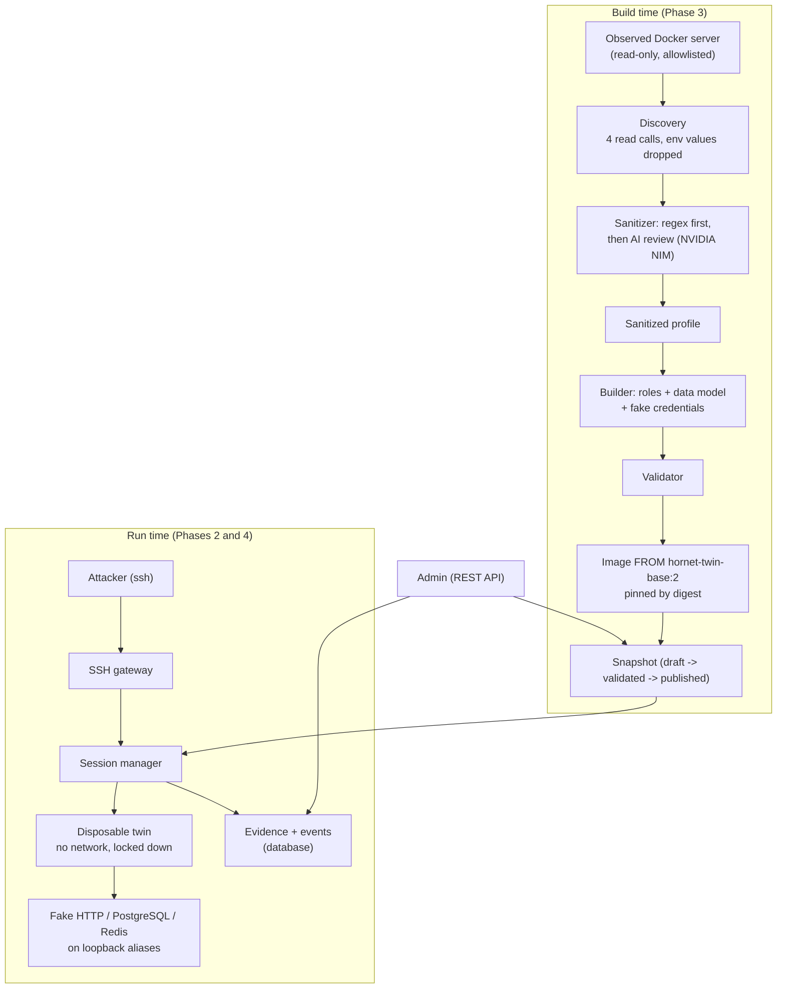

# Hornet v2: Architecture

An AI-assisted **digital-twin honeypot for Docker environments**. It watches an authorized real server, builds a sanitized synthetic copy of it, and lets attackers connect over SSH into a disposable, isolated copy where their commands really run. Everything they do is recorded as evidence.

*Status snapshot: 2026-10-16. Verified today on Windows 11 + Docker Desktop 29.8: 399 tests pass, lint is clean, working tree committed.*

---

## 1. Status at a glance

| Phase | What it delivers | Status |
|---|---|---|
| 0. Scaffolding | `pyproject.toml`, `.env.example`, `.gitignore`, Docker Compose for the management plane | **Partly done** (no CI, no `scripts/dev.py`, no pre-commit, no `.gitattributes`) |
| 1. Management foundation | Admin API, data model, migrations, immutability rules, audit | **Done and tested** |
| 2. Isolated twin execution | Hardened disposable containers, session lifecycle, evidence capture | **Done and tested** |
| 3. Discovery, sanitization, builder | Read-only discovery, regex + AI sanitizer (NVIDIA NIM), generic environment builder, pinned image | **Done and tested** (NIM verified live) |
| 4. Gateway, persistent shell, running services | SSH front door, per-connection twin, fake HTTP/PostgreSQL/Redis, linked event stream | **Done and tested** (also run by hand with real OpenSSH) |
| **5. AI synthesis** | AI answers what the fake services can't, validated in code | **Not started.** Only groundwork exists (section 8.5) |
| 6. Dashboard | React UI, live feed, attack-path tree | Not started |
| 7. Hardening, deployment, evaluation | Linux host, gVisor/microVM, fingerprint resistance, baselines | Not started |
| 8. Capstone documentation | Threat model, user guide, evaluation report | Not started |

Note: the second git commit is titled "Phases 0-5 foundation". That is generous: Phases 1 to 4 are implemented; Phase 5 is not.

**Size:** about 5,250 lines of application code, 3,970 lines of tests, a 905-line in-twin service emulator, 12 database tables, 3 migrations, 17 API routes (16 admin, 1 public).

---

## 2. What is "the base"?

"The base" is what every phase stands on. It has four layers.

### 2.1 The core idea
```
real server (observed, never touched)
   -> sanitized profile
   -> synthetic environment (versioned, immutable snapshot)
   -> disposable twin per attacker (real commands run here)
   -> AI fills only validated gaps
   -> recorded evidence + analytics
```
Three things provide realism, and none of them is trusted to do the others' job:

| Role | Provided by | Why |
|---|---|---|
| **Execution realism** | A real Linux container running the attacker's real commands | Output is genuine, never guessed |
| **Structural consistency** | A precomputed, immutable graph of the environment (the "base snapshot") | Files, users, services and credentials agree with each other |
| **Behavioral realism** | AI, limited to gaps (Phase 5) | Covers what the fakes can't, without inventing facts |

### 2.2 The base principles (these constrain all code)
1. **The observed server is an input, never an assumption.** Nothing in the code may depend on a particular demo server. Two different demos prove it.
2. **Attacker input never runs on the host.** It runs only in a disposable container created by the orchestrator.
3. **Evidence and AI output are kept apart.** Real execution results are stored separately from anything the AI proposes.
4. **Deterministic code has the last word.** Regex redaction, validators and limits run regardless of what any model says. The AI can only remove, tighten or propose; it is never trusted.
5. **Published snapshots are immutable.** A session's changes live in an overlay and never alter the base.
6. **Limits come from server-side policy,** never from attacker input.
7. **No secrets in the repo.** Keys live in `.env` (git-ignored).

### 2.3 The base technology
| Layer | Choice |
|---|---|
| Language / API | Python 3.14 in the dev venv (project allows 3.12+), FastAPI, Pydantic v2, uvicorn |
| Storage | SQLAlchemy 2 + Alembic. PostgreSQL 16 in Docker (JSONB), SQLite for unit tests and local runs |
| Containers | Docker Desktop (WSL2) via the Python `docker` SDK |
| SSH | `asyncssh` |
| AI | NVIDIA NIM (OpenAI-compatible HTTP, via `httpx`), pluggable `AIProvider` interface; offline `TemplateProvider` fallback |
| Tests / lint | pytest, ruff |
| Not yet used | React/TypeScript dashboard, gVisor/Firecracker/Kata, CI |

### 2.4 The base image: `hornet-twin-base:2`
Every twin is built `FROM` this generic Debian 12 image (303 MB). It knows nothing about any application.
- Tools an admin would expect: bash, coreutils, procps, curl, wget, iproute2, ping, ssh client, `python3`, **real `psql`**, **real `redis-cli`**.
- **No setuid/setgid binaries anywhere.**
- Two accounts: `user` (uid 1000, runs every attacker command) and `hornet-sys` (uid 1001, owns PID 1 and the service emulators, so the attacker cannot signal or read them).
- Contains the in-twin service emulator at `/usr/share/hornet/emulator.py`.
- Each discovered server gets its own derived image `FROM` this base; the image ID (digest) is pinned in the database.

### 2.5 The base data: the snapshot graph
A **snapshot** is the immutable description of one synthetic environment: a tree of nodes (directories, files, services, endpoints, users, databases) plus the pinned twin image. Once published it can never be changed (enforced in code and tested). Everything attackers do is recorded against it and linked to its nodes.

---

## 3. System overview



**Planes:** observation (discovery), construction (sanitizer, builder), execution (runtime driver, session manager, twin), telemetry (events, audit), presentation (admin API now; dashboard in Phase 6). The AI synthesis plane exists for build-time use only; its run-time use is Phase 5.

---

## 4. Repository layout

```
hornet_v2/
├── README.md  architecture.md  AGENTS.md  pyproject.toml  .env.example  docker-compose.yml
├── backend/
│   ├── app/
│   │   ├── main.py            app + lifespan (starts the gateway, reaper, clean shutdown)
│   │   ├── config.py          validated settings (unsafe config fails startup)
│   │   ├── models.py  db.py  schemas.py  services.py  graph.py  immutability.py  profile.py
│   │   ├── api/               auth.py (API key), v1.py (all admin endpoints)
│   │   ├── discovery/         docker_inventory.py (read-only wrapper, allowlist)
│   │   ├── sanitization/      patterns.py, classifier.py, sanitizer.py, ai_review.py
│   │   ├── environment/       pipeline, builder, roles, role_detect, data_model, synthetic_data,
│   │   │                      service_fixtures, plan, validator, graph_nodes, image_builder
│   │   ├── ai/                provider.py, nim_provider.py, enrichment.py, doc_validator.py
│   │   ├── runtime/           driver.py (contract), docker_driver.py, policy.py, fsdiff.py, factory.py
│   │   ├── orchestration/     session_manager.py, lifecycle.py, shell_state.py, linker.py
│   │   └── gateway/           server.py (asyncssh), auth.py
│   ├── migrations/versions/   0001 schema, 0002 session activity, 0003 gateway events
│   └── tests/                 15 test files, 399 tests
├── twin-image/                Dockerfile + emulator/hornet_emulator.py
├── main-server/               demo server 1 (a shop; fake data, canary secrets)
├── demo-servers/helpdesk/     demo server 2 (a ticket system; deliberately different)
├── scripts/                   make_papers_xlsx.py
├── reports/ research_notes/   literature research on prior work
└── Research and Limitations.xlsx
```

---

## 5. Data model (12 tables)

| Table | Purpose | Rules |
|---|---|---|
| `environment_snapshot` | One synthetic environment version: status, hash, validation/build report | Immutable once `published` or `archived` |
| `virtual_node` | The graph: directory, file, service, endpoint, user, database nodes | Same; file **contents are never stored here**, only references and hashes |
| `service_profile` | Per-service config for a snapshot (role, ports, loopback address, emulator kind) | Snapshot-owned, immutable once published |
| `twin_image` | The pinned image digest for a snapshot | Snapshot-owned |
| `honeypot_session` | One attacker session: status, runtime id, source IP, times, end reason | End reason: the **first** cause is kept |
| `execution_request` | One command the attacker typed (stored as a hash) | |
| `execution_observation` | The real result: stdout, stderr, exit code, flags | **Append-only.** Marked `source: execution` |
| `ai_synthesis` | AI proposals (Phase 5) | **Append-only.** Exists, currently unused |
| `session_event` | Timeline: lifecycle, commands, resource access, fs changes, service requests | **Append-only** |
| `session_overlay` | Per-session file changes (created/modified/deleted) | |
| `gateway_event` | Door-level events before a twin exists: connections, logins, refusals | **Append-only** |
| `admin_audit_event` | Administrator actions, separate from attacker events | **Append-only** |

Session states: `requested -> provisioning -> ready -> active -> quiescing -> destroyed`, or `failed -> destroyed`. (`archived` is allowed by the state machine but not used yet.)

---

## 6. Phase 1: Management foundation (done)

**Goal:** the API, auth and data model everything else hangs on.

- **Admin API** (FastAPI), authenticated by a constant-time-compared API key (`X-API-Key`). `/health` is the only public route.
- **Settings:** one validated object. Startup fails on a weak or placeholder admin key, SQLite in production, a non-loopback gateway outside production, or NIM selected without a key.
- **Immutability guards** (`immutability.py`) hook the ORM session: published/archived snapshots and everything they own cannot be changed or deleted; evidence, event and audit tables are append-only.
- **Graph rules** (`graph.py`): paths are normalized and can't escape the virtual root; one root; valid parents; no duplicates or cycles.
- **Snapshot lifecycle:** `build -> validate -> publish`. Publishing archives the previous published snapshot atomically. A failed build never replaces the active one.
- **Audit:** every admin action is recorded.

**Verified:** migrations apply and roll back (SQLite for all three; PostgreSQL 16 for 0001 and 0002, **0003 was verified on SQLite only**); modifying a published snapshot raises an error (tested).

---

## 7. Phase 2: Isolated twin execution (done)

**Goal:** run a command in a disposable sandbox and capture real evidence.

### 7.1 Runtime driver
`RuntimeDriver` is the interface the rest of the system uses (create, exec, observe filesystem, list processes, start services, collect service events, destroy). Today there is one implementation, `HardenedDockerDriver`. gVisor/Kata/Firecracker drivers can be added without touching the orchestrator.

### 7.2 What every twin gets
| Control | Setting |
|---|---|
| Network | `none` (loopback only) |
| Mounts / Docker socket / privileged | none |
| Capabilities | all dropped (effective set is empty); `no-new-privileges`; default seccomp |
| Filesystem | read-only root; small writable tmpfs for `/tmp`, `/var/tmp`, the home directory |
| Limits (defaults) | 128 MB RAM, 0.5 CPU, 64 processes, 256 open files, 16 MB per writable area |
| Per command | 5 s timeout (killed with SIGKILL), 64 KB output cap, 8 KB input cap |
| Users | PID 1 runs as uid 1001; attacker commands run as uid 1000 and cannot signal it |
| Hard maxima | Config can't exceed them (e.g. timeout at most 60 s, RAM at most 1 GB, 512 processes) |
| Cleanup | Labelled containers; orphans from a crash are removed on the next start; shutdown destroys all twins |

### 7.3 The session manager (orchestrator)
Owns the lifecycle and enforces: a maximum number of concurrent sessions (default 5), a lifetime (900 s) and an idle timeout (300 s), with a background reaper. Each command is recorded as a request (hash only) plus an observation (the real output).

### 7.4 Observation
After each command: stdout, stderr, exit code, duration, whether it timed out or was truncated; a **filesystem diff** of the writable areas (created/modified/deleted); the process list (taken from the host side, so it works even when the twin can't fork).

### 7.5 Failure handling
- Timeout: the command is killed and the twin stays usable.
- Output flood: capped; the runaway process is killed and the stream drained.
- **Fork bomb:** the host is never at risk. The manager detects a full process table, marks the session failed ("limit exceeded: process limit") and destroys the twin.
- Image/digest mismatch: refused; nothing is launched.

**Verified (real Docker):** a fork bomb, memory hog, 1 GB write, infinite loop, output flood, docker-socket and network probes, capability and privilege checks, kill-PID-1, mount, and cross-session isolation.

**Limit:** on Windows the kernel is shared with the Docker Desktop VM, so this is weaker than gVisor or a microVM. Don't expose it to the internet.

---

## 8. Phase 3: Discovery, sanitization, builder (done)

**Goal:** turn an authorized real Docker server into a versioned synthetic snapshot.

### 8.1 Discovery (read-only)
- `ReadOnlyDocker` exposes exactly four read calls (list containers, inspect, diff, list networks) and holds no handle to anything that can exec, start, stop or copy.
- Only compose projects listed in `HORNET_DISCOVERY_ALLOWED_PROJECTS` can be observed (default: none). Hornet's own twins are excluded.
- **Environment variable values are dropped at the source:** only names are kept. A test proves nothing was exec'd or restarted in the production containers.

### 8.2 Sanitization (two layers)
1. **Deterministic (always runs first, always has the last word).** Regex detectors for URL credentials, cloud keys, tokens, JWTs, `--password x`, `curl -u u:p`, private keys, emails, IPs, host paths, and high-entropy strings. Host-side mount paths, compose bookkeeping labels and private registry hosts are removed. A second pass (`assert_clean`) fails the build if anything sensitive survived.
2. **AI review (NVIDIA NIM).** Sees only already-redacted text. Returns substrings that must appear verbatim in what it was sent; code replaces them with `redacted-<category>`. It cannot add or rewrite data; it can only mark plain config variables as secret. The project and service names are protected; structural fields (paths, commands) can't be wiped out. Modes: `required` (build fails if the model is unavailable), `advisory`, `off`.

### 8.3 The builder (generic by construction)
Sanitized profile -> **plan** -> validated -> image.
- **Roles** are detected from the image, command line and published ports: `postgres`, `mysql`, `redis`, `nginx`, `http-app`, or `generic`. Any server works; unknown services get a generic twin.
- **Data model:** a validated schema (tables and typed columns) either proposed by the AI or chosen by keyword (commerce, helpdesk, content) or a neutral default. Rows are generated from column types with fictional people, so emails, logs and SQL agree.
- **Fake credentials are consistent across files** (`.env`, init SQL, `~/.pgpass`, `redis.conf`, and the emulator config) so what an attacker steals actually works.
- **Files generated:** users and `/etc/passwd`, configs, logs, a seeded home with bait files, an app source stub that follows the runtime hint (python, node, or plain config).
- **AI documents** (shell history, notes) are validated: allowed folders only, no overwrites, no secrets, only fictional emails and documentation-range IPs. A failure never fails a build.
- **Validator:** graph invariants, owners exist, credentials match across files, no non-synthetic emails/IPs, a leak scan with the planned fake secrets removed, size limits.
- **Image:** written as a build context, built `FROM` the base, pinned by ID, recorded with the snapshot. **Atomic:** any failure leaves no snapshot and removes the half-built image.

### 8.4 Verified
Canary secrets planted everywhere in both demo servers appear nowhere in the stored profile, build context, database, audit log or image. The same test body passes for both demo servers. NIM was verified **live** (details in the README); it found a person's name no regex can catch.

### 8.5 Groundwork that Phase 5 will reuse
`AIProvider` interface and `NimProvider`, `ai_synthesis` table, the `unsupported` flags emitted by the emulators, the `ai/doc_validator.py` approach (validate AI output in code), and `HORNET_AI_*` settings.

---

## 9. Phase 4: Gateway, persistent shell, running services (done)

**Goal:** let an attacker connect and get their own twin.

### 9.1 SSH gateway (`asyncssh`)
- Off by default (`HORNET_GATEWAY_ENABLED`), loopback only, runs inside the API process and shares its session manager.
- **Login:** any username. A password succeeds on the Nth attempt of a connection (default 3) or at once if it is a known-weak password. Public keys are refused but fingerprints are logged. Every attempt is stored (`gateway_event`); passwords are logged by default (research data) or reduced to length + hash.
- **One twin per connection,** created when the first shell/exec channel opens, destroyed when the connection closes. Reconnecting gives a clean twin.
- **Refused and logged:** SFTP/SCP and all subsystems, direct/remote/unix port forwarding, agent and X11 forwarding.
- **Limits:** per-address connection limit, twin capacity limit, login timeout, idle logout. A limit violation ends the connection.
- Supports a terminal session (prompt, history, line editing) **and** `ssh host "command"`, preserving the real exit code.

### 9.2 The persistent shell
Each command is its own process (so each is separate evidence), wrapped so the next starts in the same directory with the same exported variables. A per-command random marker carries the new state back and is stripped from the output. The evidence records exactly what was typed.

### 9.3 Running fake services (inside each twin)
A single stdlib-only Python program (`twin-image/emulator/hornet_emulator.py`) runs as the system user and serves, each on its own loopback address (`127.0.1.N`), reachable by the original service name:

| Service | Protocol support |
|---|---|
| HTTP API | `GET/POST/PUT/PATCH/DELETE` over the tables, filtering, limits, JSON errors |
| PostgreSQL | Wire protocol, md5 auth, simple queries, a useful SQL subset, `information_schema`, `\dt`, real error codes (`42P01`, `28P01`, `42501` ...) |
| Redis | RESP, `AUTH`, strings, hashes, `KEYS`, `INFO`; dangerous commands refused |

All services share one in-memory store (a row created via the API appears in SQL) and the state dies with the twin. Real `psql`, `curl` and `redis-cli` work against them. Unsupported requests get a controlled error and an `unsupported` event (the Phase 5 hook).

### 9.4 Event stream and graph links
- `resource_access`: a command named a path that exists in the graph (labelled `basis: command-argument`: an observation, **not proof** of a read).
- `fs_change`: a file was created/modified/deleted (from the filesystem diff).
- `service.http|postgres|redis`: a request to a fake service, linked to the service's node. Passwords are never stored by the emulators.
- The twin cannot read the emulator's config or event log (mode 0600/0700, owned by the system user).

### 9.5 Verified
Real SSH client against the live server, and real Docker twins built from both demo servers: persistence, fake services answering real clients, two simultaneous connections isolated, clean reconnect, no route to the host/gateway/other sessions, fork-bomb handling, config and events unreadable to the attacker, shutdown leaves no twins. Also run by hand with OpenSSH 10.3.

---

## 10. Phase 5: AI synthesis (planned, not started)

**Goal:** the AI fills gaps only, safely.

**The problem:** the fake services support a limited set of requests. Anything else gets a plain error. A careful attacker notices (an unusual SQL feature, `CLIENT LIST` in Redis, an API route that doesn't exist).

**Routing (in order):**
1. Real command output: used unchanged. The AI never touches shell output.
2. A fake service knows the answer: use the deterministic answer.
3. Otherwise: ask the AI for a response in a strict JSON format, validate it in code, return it; on failure or timeout fall back to the existing controlled error.

**Planned components**
| Component | Job |
|---|---|
| Context builder | Minimal sanitized context (schema names, a few recent events); attacker text labelled untrusted |
| Router | Decides real / fixture / AI |
| Output validator | JSON schema, referenced tables/columns/files exist, only whitelisted state changes, consistent with existing data, no secrets or real-looking addresses |
| Bridge | The services are in a twin with no network, so they can't call the AI. They publish "I can't answer this" and wait briefly; the orchestrator calls the model and sends the answer back |
| Storage | The real request and the AI proposal stored as separate records (`ai_synthesis`), with an `ai_policy_version` |

**Design constraints**
- **Latency is the main risk.** The currently configured model is a slow reasoning model (7 to 17 s per call), fine for builds but too slow for live use. Plan: a faster non-reasoning model, a hard timeout of about 2 to 3 s, caching of repeated questions, and the plain-error fallback.
- With the provider disabled, the whole system must still work.

**Exit criteria:** an AI-consistency suite passes (prompt injection, invented files, inconsistent records, secret leakage), and the system works with the AI off.

---

## 11. Admin API

All routes are under `/api/v1`. Everything except `/health` needs `X-API-Key`.

| Method and path | Purpose |
|---|---|
| `GET /health` | Database, runtime and gateway status (public) |
| `POST /discovery/preview` | Discover + sanitize only; returns the sanitized profile, builds nothing |
| `POST /environments/build` | `source: "seed"` (hand-written tree) or `"docker"` (discover, sanitize, build image) |
| `GET /environments`, `GET /environments/{id}` | List / inspect snapshots (includes the build report) |
| `POST /environments/{id}/validate`, `POST .../publish` | Validate; publish (explicit, atomic) |
| `GET /environments/{id}/tree` | The base graph |
| `POST /sessions`, `POST /sessions/{id}/exec`, `DELETE /sessions/{id}` | Admin test console for a twin |
| `GET /sessions`, `GET /sessions/{id}`, `GET /sessions/{id}/events` | Sessions and their timelines |
| `GET /gateway/events` | Connections, logins (filter by type or IP) |
| `GET /analytics/overview`, `GET /audit` | Counts; administrator audit log |

OpenAPI docs: `/docs`. Attacker-supplied text inside events must always be escaped when rendered.

---

## 12. Configuration (environment variables, prefix `HORNET_`)

| Group | Settings |
|---|---|
| Core | `ENV` (dev/prod), `DATABASE_URL`, `ADMIN_API_KEY` (required, 16+ chars) |
| Twin runtime | `TWIN_BASE_IMAGE`, `TWIN_TIMEOUT_MS`, `TWIN_OUTPUT_LIMIT_BYTES`, `TWIN_MEMORY_MB`, `TWIN_CPUS`, `TWIN_PIDS`, `TWIN_TMPFS_MB`, `MAX_ACTIVE_SESSIONS`, `SESSION_TTL_S`, `IDLE_TTL_S` |
| Discovery / build | `DISCOVERY_ALLOWED_PROJECTS`, `BUILD_DIR` |
| AI | `AI_PROVIDER` (template/nim), `NVIDIA_API_KEY`, `NIM_MODEL`, `NIM_BASE_URL`, `NIM_TIMEOUT_S`, `NIM_MAX_TOKENS`, `AI_SANITIZER_MODE` (required/advisory/off) |
| Gateway | `GATEWAY_ENABLED`, `GATEWAY_HOST`, `GATEWAY_PORT`, `GATEWAY_HOST_KEY_PATH`, `GATEWAY_SERVER_VERSION`, `GATEWAY_ACCEPT_AFTER`, `GATEWAY_WEAK_PASSWORDS`, `GATEWAY_LOG_PASSWORDS`, `GATEWAY_MAX_CONNECTIONS_PER_IP`, `GATEWAY_LOGIN_TIMEOUT_S` |

Run instructions and things to try are in `README.md`.

---

## 13. Security model

### 13.1 What is enforced
- Twins have no network, no mounts, no Docker socket and no capabilities; commands are time-, memory-, process- and output-limited by server policy.
- Discovery is read-only, allowlisted, and never reads environment values.
- Sanitization is layered; the AI sees only redacted text and cannot add data; deterministic checks run last.
- Snapshots are immutable; evidence tables are append-only.
- The attacker cannot read or stop the fake services, or reach the host, the gateway or other sessions.
- The gateway binds to loopback unless `ENV=prod`.
- API keys are masked secrets, kept in `.env`, never logged.

### 13.2 What is not protected (be aware)
- **Windows isolation is the weaker kind** (shared kernel with the Docker Desktop VM).
- **A careful attacker can tell it's a honeypot:** `uname -r` shows a WSL2 kernel; `ps` shows the emulator process; the emulator files live under `/usr/share/hornet`; the SSH handshake is asyncssh behind an OpenSSH-style banner.
- The login name is cosmetic (the shell is always the unprivileged `user`).
- No interactive programs (`vim`, `top`, password prompts); Ctrl-C doesn't interrupt a running command; output is decoded as UTF-8 text so binary output is corrupted.
- A hosted NIM model receives sanitized metadata; for sensitive servers use a self-hosted NIM.
- The regex scanner is heuristic, not a guarantee.
- Container escape and egress abuse are not quantified; a Linux evaluation is Phase 7.

---

## 14. Testing (399 tests, all passing)

| File | Tests | Covers |
|---|---|---|
| `test_sanitization.py` | 60 | Detectors, classification, read-only discovery, the canary leak test |
| `test_nim_and_ai_review.py` | 50 | NIM client (mock transport), AI review rules, regressions found live |
| `test_generic_shapes.py` | 49 | Any server shape, data models, role detection |
| `test_environment.py` | 44 | Builder, validator, AI documents, pipeline, failure paths |
| `test_emulator.py` | 37 | HTTP, Redis, PostgreSQL protocols over real sockets |
| `test_stateful_shell.py` | 30 | Shell state, graph linking, service events |
| `test_api.py` | 24 | Endpoints, auth, hermetic-test guard |
| `test_session_manager.py` | 23 | Lifecycle, limits, reaper, failure handling |
| `test_gateway.py` | 20 | SSH server with a real client (in-memory runtime) |
| `test_docker_gateway.py` | 18 | **Real Docker:** SSH into real twins, both demo servers |
| `test_graph.py` | 17 | Path and tree rules |
| `test_docker_isolation.py` | 13 | **Real Docker:** hostile commands |
| `test_immutability.py` | 7 | Snapshot and append-only guards |
| `test_docker_build.py` | 4 | **Real Docker:** discovery to image to twin, both demo servers |
| `test_fsdiff.py` | 3 | Filesystem diff |

- 35 tests need Docker and the demo stacks; they skip themselves if those are missing.
- **The suite is hermetic:** it ignores your `.env` AI settings and key and never calls a real model.
- Run: `.\.venv\Scripts\python.exe -m pytest backend/tests` (about 2 minutes with Docker).
- **Not yet tested:** Linux, CI, PostgreSQL migration 0003, more than one Docker host.

---

## 15. Known gaps and risks

| Item | Detail |
|---|---|
| Phase 5 not built | Unsupported requests still get a plain error |
| Phase 0 incomplete | No CI, no `scripts/dev.py`, no pre-commit/mypy (AGENTS.md lists them) |
| Linux / CI untested | Everything was verified on Windows 11 only |
| Fingerprinting | See section 13.2; a Phase 7 item |
| Single process | Sessions live in memory; an API restart destroys every twin; one process per Docker host |
| AI quality | Model sanitization checked on two small demo servers; it produces harmless false positives |
| AI latency | Builds take about 1.5 to 2 minutes with the current reasoning model |
| Prior art | TwinPot-Gen and HoneyLLM were read only at abstract level; CounterCraft is closed commercial. Re-check novelty claims before final writing |

---

## 16. What comes next

1. **Phase 5: AI synthesis** (section 10). Start by choosing a fast model and defining the request/response bridge.
2. **Phase 6: Dashboard.** React + TypeScript; live feed; environment tree with base / visited / overlay states; session timeline; raw-vs-AI evidence panel; XSS-safe rendering of attacker text.
3. **Phase 7: Hardening and evaluation (Linux).** gVisor or a microVM; fingerprint resistance; escape/egress suites; comparison against Cowrie, an LLM-only shell and a real Ubuntu control; an AI-attacker detection test.
4. **Phase 8: Capstone documents.** Threat model, user guide, evaluation report, demo script.

Related documents: `README.md` (how to run and try it), `AGENTS.md` (rules and phase plan), `reports/LLM honeypot digital twin prior work.md` (novelty research), `Research and Limitations.xlsx` (per-paper and per-product limitations).
