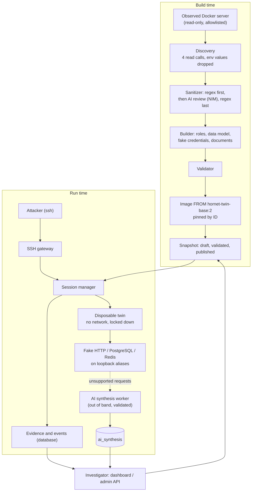

# Hornet v2: Architecture

An AI-assisted **digital-twin honeypot for Docker environments**. It watches an authorized real server (read-only),
builds a sanitized synthetic copy of it, and lets attackers connect over SSH into a disposable, isolated copy where
their commands really run. Everything they do is recorded as evidence and shown in a dashboard.

*Status: 2026-10-26. Verified on Linux (CachyOS, kernel 7.3, Python 3.14, Docker with runc and gVisor): 604
backend tests (115 against real Docker or PostgreSQL; 4 skipped as documented gVisor/runc exceptions) and 64
dashboard tests pass; the real-Docker tests also pass with every twin under gVisor; ruff, mypy and ESLint are clean.
CI runs on GitHub for Linux (unit, real-Docker integration on runc and gVisor, dashboard) and Windows (unit).*

Related documents: [README.md](README.md) (overview and reference), [docs/user-guide.md](docs/user-guide.md) (install
and use), [docs/demo-script.md](docs/demo-script.md) (the presentation), [docs/threat-model.md](docs/threat-model.md),
[docs/evaluation-report.md](docs/evaluation-report.md), [docs/limitations.md](docs/limitations.md),
[AGENTS.md](AGENTS.md) (rules and phases).

---

## 1. Status at a glance

| Phase | What it delivers | Status |
|---|---|---|
| 0. Scaffolding | `pyproject.toml`, `.env.example`, task runner `scripts/dev.py`, `.gitattributes`, CI (Linux + Windows) | Done (mypy added in Phase H) |
| 1. Management foundation | Admin API, data model, migrations, immutability rules, audit | Done |
| 2. Isolated twin execution | Hardened disposable containers, session lifecycle, evidence capture | Done |
| 3. Discovery, sanitization, builder | Read-only discovery, regex + AI sanitizer (NVIDIA NIM), generic builder, pinned image | Done |
| 4. Gateway, persistent shell, fake services | SSH front door, one twin per connection, fake HTTP/PostgreSQL/Redis, linked events | Done |
| 5. AI synthesis | **5A done:** AI proposals for requests the fake services cannot answer, validated in code, stored apart from evidence, never shown to the attacker. 5B (live serving) is optional and not built | 5A done |
| 6. Dashboard (+ 6.5 redesign) | React dashboard: live feed, session replay, raw-vs-AI inspector, environment map, plain-English summaries | Done |
| 7. Demo security and evaluation | Egress, cross-session and canary tests; demo safety check; measurements; limitations | Done |
| 8. Documentation | User guide, threat model, evaluation report, demo script | Done (this phase) |
| H. Full hardening | gVisor driver, full escape suite, PostgreSQL triggers, `prod` profile, deployment design, mypy | Done, **awaiting approval** |

**Size:** about 6,360 lines of backend code, 5,250 lines of backend tests, a 917-line in-twin service emulator,
2,190 lines of dashboard code and 500 lines of dashboard tests; 12 database tables, 4 migrations, 20 REST routes
(19 admin, 1 public) and 1 WebSocket.

---

## 2. Principles and building blocks

### 2.1 The core idea
```
real server (observed, never touched)
   -> sanitized profile
   -> synthetic environment (versioned, immutable snapshot)
   -> disposable twin per attacker (real commands run here)
   -> AI proposes answers only for validated gaps (out of band)
   -> recorded evidence + dashboard
```
| Role | Provided by | Why |
|---|---|---|
| **Execution realism** | A real Linux container running the attacker's real commands | Output is genuine, never guessed |
| **Structural consistency** | A precomputed, immutable graph of the environment (the snapshot) | Files, users, services and credentials agree |
| **Behavioral coverage** | AI, limited to gaps the fake services flag | Shows what a real server might have said, without inventing evidence |

### 2.2 Principles (these constrain all code)
1. **The observed server is an input, never an assumption.** No code outside tests and the demo folders mentions a
   particular demo; every build test runs against two deliberately different demo servers.
2. **Attacker input never runs on the host.** Only in a disposable container created by the orchestrator.
3. **Evidence and AI output are kept apart,** in storage (separate tables) and on screen (separate panels).
4. **Deterministic code has the last word.** Redaction, validators and limits run whatever a model says; models can
   only remove, tighten or propose.
5. **Published snapshots are immutable.** A session's changes live in its overlay.
6. **Limits come from server-side policy,** never from attacker input. The demo profile may tighten, never loosen.
7. **No secrets in the repo.** Keys live in `.env` (git-ignored); tests use fake canary values.

### 2.3 Technology
| Layer | Choice |
|---|---|
| Backend | Python 3.12+ (3.14 in development), FastAPI, Pydantic v2, uvicorn |
| Storage | SQLAlchemy 2 + Alembic; SQLite for development and tests, PostgreSQL 16 required in production |
| Containers | Docker via the Python `docker` SDK; hardened-Docker runtime (runc), or gVisor (`runsc`) on Linux |
| SSH | `asyncssh` |
| AI | NVIDIA NIM (OpenAI-compatible HTTP via `httpx`) behind an `AIProvider` interface; offline `TemplateProvider` |
| Dashboard | React 19, TypeScript, Tailwind CSS 4, Vite; self-hosted fonts |
| Tests / lint | pytest, ruff; Vitest + Testing Library, ESLint, `tsc`; GitHub Actions |

### 2.4 The base image `hornet-twin-base:2`
A generic Debian 12 image that knows nothing about any application: bash, coreutils, procps, curl, wget, iproute2,
ping, an SSH client, `python3`, the real `psql` and `redis-cli`. **No setuid/setgid binaries.** Two accounts: `user`
(uid 1000, runs every attacker command) and `hornet-sys` (uid 1001, owns PID 1 and the fake services). Each built
environment gets its own image `FROM` this base, pinned by image ID.

### 2.5 The snapshot graph
A snapshot is the immutable description of one synthetic environment: nodes for directories, files, services,
endpoints, users and databases (with table and column names), each with a sensitivity class (`public` or
`synthetic-sensitive` for files holding fake credentials), plus the pinned image. Everything attackers do is linked
to its nodes.

---

## 3. System overview



---

## 4. Repository layout

```
HornetV2/
├── README.md  architecture.md  AGENTS.md  READING_GUIDE.md  pyproject.toml  .env.example  docker-compose.yml
├── backend/
│   ├── app/
│   │   ├── main.py  config.py  models.py  db.py  schemas.py  services.py  graph.py  immutability.py
│   │   │   profile.py  retention.py
│   │   ├── api/            auth.py, v1.py (REST), live.py (WebSocket live feed)
│   │   ├── discovery/      docker_inventory.py (read-only wrapper, allowlist)
│   │   ├── sanitization/   patterns.py, classifier.py, sanitizer.py, ai_review.py
│   │   ├── environment/    pipeline, builder, roles, role_detect, data_model, synthetic_data, service_fixtures,
│   │   │                   plan, validator, graph_nodes, image_builder
│   │   ├── ai/             provider, nim_provider, enrichment, doc_validator, synthesis, synthesis_context,
│   │   │                   synthesis_validator
│   │   ├── runtime/        driver.py (contract), docker_driver.py, policy.py, fsdiff.py, factory.py
│   │   ├── orchestration/  session_manager, lifecycle, shell_state, linker, service_events
│   │   └── gateway/        server.py (asyncssh), auth.py
│   ├── migrations/versions/  0001 schema, 0002 session activity, 0003 gateway events, 0004 command text
│   └── tests/              25 test files incl. ai_consistency/ (604 tests)
├── frontend/               dashboard (src/views, src/components, src/lib, src/test)
├── twin-image/             Dockerfile + emulator/hornet_emulator.py
├── main-server/  demo-servers/helpdesk/   two deliberately different demo servers (fake data, canary secrets)
├── scripts/                dev.py (task runner), evaluate.py, measure_synthesis.py, seed_demo_session.py
├── docs/                   user guide, demo script, threat model, evaluation report, limitations, results/
└── .github/workflows/ci.yml
```

---

## 5. Data model (12 tables)

| Table | Purpose | Rules |
|---|---|---|
| `environment_snapshot` | One environment version: status, hash, validation and build report | Immutable once published or archived |
| `virtual_node` | The graph: directory, file, service, endpoint, user, database nodes | Same; file contents are never stored, only references and hashes |
| `service_profile` | Per-service config (role, ports, loopback address, emulator kind) | Snapshot-owned, immutable once published |
| `twin_image` | The pinned image ID of a snapshot | Snapshot-owned |
| `honeypot_session` | One visit: status, runtime id, source IP, times, end reason, AI policy version | The **first** end reason is kept |
| `execution_request` | One command: `input_hash` (raw), `input_text` (credentials redacted), `input_raw` (only if enabled) | |
| `execution_observation` | The real result: stdout, stderr, exit code, flags | **Append-only**; `source: execution` |
| `ai_synthesis` | AI proposals for `unsupported` requests, one per gap, never served | **Append-only** |
| `session_event` | Timeline: lifecycle, commands, resource access, file changes, service requests | **Append-only** |
| `session_overlay` | Per-session file changes | |
| `gateway_event` | Connections, login attempts, refusals | **Append-only** |
| `admin_audit_event` | Administrator actions (including reads of command text) | **Append-only** |

Append-only and immutability rules are enforced on every ORM flush (`immutability.py`). The only path allowed to
delete recorded data is the audited retention purge (`retention.py`). Session states:
`requested -> provisioning -> ready -> active -> quiescing -> destroyed`, or `failed -> destroyed`.

---

## 6. Management (Phase 1)

- **Admin API** (FastAPI). Every route except `/health` needs `X-API-Key` (constant-time comparison).
- **Settings** (`config.py`): one validated object. Startup fails on a weak admin key, SQLite in production, NIM
  without a key, a wildcard dashboard origin, and in the **demo profile** (`HORNET_ENV=dev`) on anything that would
  loosen the demo: a non-loopback gateway or dashboard origin, raw command storage, or a twin limit above its
  default. `python -m scripts.dev safety` prints the effective safety settings.
- **Snapshot lifecycle:** build, validate, publish; publishing archives the previous version atomically; a failed
  build never replaces the published one.
- **Audit:** every administrator action, including each read of a session's commands and each live-feed connection.
- **Migrations:** apply and roll back on SQLite and on PostgreSQL 16 (all five, tested). On PostgreSQL, 0005 adds
  triggers that refuse changes to published snapshots and append-only tables even through raw SQL; only the
  retention purge's own transaction may delete, and never the audit log.

---

## 7. Isolated twins (Phase 2)

`RuntimeDriver` is the only way the orchestrator touches a twin (create, exec, observe files, list processes, start
services, collect service events, destroy). One implementation today: `HardenedDockerDriver`.

| Control | Setting |
|---|---|
| Network | `none` (loopback only); no route out by TCP, UDP, DNS, ICMP or IPv6 (tested) |
| Mounts / Docker socket / privileged | none (tested) |
| Capabilities | all dropped; `no-new-privileges`; default seccomp |
| Filesystem | read-only root; size-limited tmpfs for `/tmp`, `/var/tmp` and the home directory |
| Default limits (demo ceilings) | 128 MB RAM, 0.5 CPU, 64 processes, 256 open files, 16 MB per writable area |
| Per command | 5 s timeout (SIGKILL), 64 KB output cap, 8 KB input cap |
| Users | PID 1 runs as uid 1001; attacker commands as uid 1000, unable to signal it |
| Cleanup | labelled containers; orphans removed on the next start; shutdown destroys all twins |

The **session manager** owns the lifecycle: at most 5 concurrent twins, 900 s lifetime, 300 s idle timeout, a
background reaper. After each command it stores the observation, the filesystem diff, the process count, links to
graph nodes and the fake services' events. A full process table (fork bomb) or a hung twin ends the session
("limit exceeded") and destroys the twin. **Tested on real Docker:** fork bomb, memory hog, output flood, timeouts,
1 GB write, kill PID 1, capabilities, Docker socket, egress, cross-session files, processes and fake-service state.

---

## 8. Building environments (Phase 3)

1. **Discovery (read-only):** `ReadOnlyDocker` exposes four read calls only; only allowlisted compose projects
   (`HORNET_DISCOVERY_ALLOWED_PROJECTS`); environment variable **values are dropped at the source**.
2. **Sanitization:** deterministic redaction first (URL credentials, keys and tokens, JWTs, `NAME_PASSWORD=` style
   assignments, `--password x`, `-u user:pass`, private keys, emails, IPs, host paths, high-entropy strings); then an
   optional AI review that only sees redacted text and can only remove; then `assert_clean` again, which fails the
   build on any leftover. Modes `required` (fail closed), `advisory`, `off`.
3. **Builder:** roles from image, command line and ports (`postgres`, `mysql`, `redis`, `nginx`, `http-app`,
   `generic`); a validated data model (AI-proposed or keyword default); fake credentials consistent across `.env`,
   init SQL, `~/.pgpass`, `redis.conf` and the fake services; logs, users, bait files, AI-written documents
   (validated).
4. **Validator:** graph invariants, owners, cross-file credential consistency, synthetic-only emails and IPs, leak
   scan, size limits.
5. **Image:** built `FROM` the base, pinned, recorded; any failure removes it and leaves no snapshot.

Canary secrets planted in both demo servers appear nowhere in the profile, build folder, database, audit log, image,
running twin, **any prompt sent to a model, or any log line** (tested, Phase 7.2).

---

## 9. Visitors, shell and fake services (Phase 4)

- **SSH gateway** (`asyncssh`, off by default, loopback only in the demo profile). Any username; a password works
  on the 3rd attempt or at once if it is a known weak one. Every attempt is recorded (password as length + hash by
  default). One twin per connection; reconnecting gives a clean twin. SFTP/SCP, port forwarding, agent and X11
  forwarding are refused and logged. Interactive shells and `ssh host "command"` both work.
- **Persistent shell:** each command is its own process, wrapped so the next one starts in the same directory with
  the same exported variables; the stored command is what was typed (credentials redacted), not the wrapper.
- **Fake services** (one stdlib-only program inside the twin, as the system user, on `127.0.1.N`, reachable by the
  original service names): an HTTP table API, PostgreSQL (wire protocol, md5 auth, a SQL subset, catalog views, real
  error codes) and Redis (RESP, AUTH, strings, hashes; dangerous commands refused). They share one in-memory store per
  twin; state dies with the twin. Requests they cannot answer get a controlled error and an `unsupported` event
  ([docs/service-events.md](docs/service-events.md)).
- **Events:** `resource_access` (a command named a graph path: an observation, not proof of a read), `fs_change`,
  `service.http|postgres|redis`, lifecycle events; gateway events separately.

---

## 10. AI synthesis (Phase 5A)

After a command, each `unsupported` service event goes to a background worker (`ai/synthesis.py`). The attacker
never waits for it and never sees its answer. The worker:
1. builds a minimal context (`synthesis_context.py`): table and column names, the request with credentials
   redacted, injection phrasing and control characters stripped, labelled untrusted;
2. calls the model with a hard timeout (default 3 s), a per-session cap (20) and a cache;
3. validates the answer in code (`synthesis_validator.py`): strict per-protocol shape; no tables, columns or API
   resources the snapshot lacks; no error that contradicts the schema; writes may only get errors; real SQLSTATEs only;
   no secret-like strings, only example email domains and documentation IPs; size caps;
4. stores one `ai_synthesis` row: `accepted`, `rejected`, `timeout` or `fallback`, with `served: false`.

For speed the synthesis client asks NIM reasoning models to answer without "thinking" and does not use NVIDIA's
guided decoding (both measured, [docs/results/synthesis_latency.md](docs/results/synthesis_latency.md)). Builds keep
the model's defaults. **Model availability changes:** the code's default synthesis model
(`nvidia/nemotron-3-super-120b-a12b`) returned HTTP 404 from 2026-10-20; the demo uses
`nvidia/nemotron-3.5-super-vl-120b-a12b` via `.env`. With synthesis off (the default) or the provider down, nothing
else changes.

---

## 11. Dashboard (Phase 6 and 6.5)

`frontend/` talks to the admin API through the Vite dev server's proxy on `127.0.0.1:5173` (REST and WebSocket, so
the browser only uses its own origin). The admin key lives in the tab's memory only; the theme choice is the only
thing in browser storage.

| Piece | Where |
|---|---|
| Live feed | `WS /api/v1/ws/events` (`api/live.py`): key in the first message (4401 if wrong), foreign Origin refused (4403), database polled every second, audited |
| Tree state | `GET /sessions/{id}/tree-state`: base, visited, overlay and sensitivity per node |
| Plain English | `lib/describe.ts` (one sentence per event type), `lib/story.ts` ("What happened" summary, built from evidence, no AI), `lib/glossary.ts` |
| Safe rendering | attacker text only through `AttackerText`/`Output` (text nodes); ESLint forbids every HTML-injection API; control and bidi characters shown visibly; no attacker text in attributes |
| Raw vs AI | `ExecutionInspector.tsx`: "What really happened" and "AI suggestion" are separate panels |
| Accessibility | WCAG AA contrast for every text/background pair in both themes (tested), keyboard focus, screen-reader labels |

---

## 12. Admin API

All routes are under `/api/v1`; everything except `/health` needs `X-API-Key`. OpenAPI docs at `/docs`.

| Method and path | Purpose |
|---|---|
| `GET /health` | Database, runtime and gateway status (public) |
| `POST /discovery/preview` | Discover and sanitize only; returns the sanitized profile |
| `POST /environments/build` | `source: "docker"` (discover, sanitize, build image) or `"seed"` (hand-written tree, tests) |
| `GET /environments`, `GET /environments/{id}`, `GET /environments/{id}/tree` | Snapshots and their base graph |
| `POST /environments/{id}/validate`, `POST /environments/{id}/publish` | Validate; publish (atomic) |
| `GET /sessions`, `GET /sessions/{id}` | Visits, with command and AI-suggestion counts |
| `GET /sessions/{id}/executions` | Commands (redacted), raw output and, separately, AI proposals (audited) |
| `GET /sessions/{id}/events`, `/overlay`, `/tree-state` | Timeline, file changes, tree with markers |
| `POST /sessions`, `POST /sessions/{id}/exec`, `DELETE /sessions/{id}` | Admin test console for a twin |
| `GET /gateway/events` | Connections and login attempts |
| `GET /analytics/overview`, `GET /audit` | Counts; the administrator audit log |
| `WS /ws/events` | Live feed (key in the first message) |

---

## 13. Configuration (prefix `HORNET_`, in `.env`)

| Group | Settings |
|---|---|
| Core | `ENV` (`dev` = demo profile, `prod`), `DATABASE_URL`, `ADMIN_API_KEY` (16+ chars) |
| Twin limits | `TWIN_BASE_IMAGE`, `TWIN_TIMEOUT_MS`, `TWIN_OUTPUT_LIMIT_BYTES`, `TWIN_MEMORY_MB`, `TWIN_CPUS`, `TWIN_PIDS`, `TWIN_TMPFS_MB`, `MAX_ACTIVE_SESSIONS`, `SESSION_TTL_S`, `IDLE_TTL_S` |
| Discovery / build | `DISCOVERY_ALLOWED_PROJECTS`, `BUILD_DIR` |
| AI | `AI_PROVIDER` (`template`/`nim`), `NVIDIA_API_KEY`, `NIM_MODEL`, `NIM_BASE_URL`, `NIM_TIMEOUT_S`, `NIM_MAX_TOKENS`, `AI_SANITIZER_MODE`, `AI_SYNTH_ENABLED`, `AI_SYNTH_TIMEOUT_S`, `AI_SYNTH_MAX_PER_SESSION`, `NIM_SYNTH_MODEL` |
| Gateway | `GATEWAY_ENABLED`, `GATEWAY_HOST`, `GATEWAY_PORT`, `GATEWAY_HOST_KEY_PATH`, `GATEWAY_SERVER_VERSION`, `GATEWAY_ACCEPT_AFTER`, `GATEWAY_WEAK_PASSWORDS`, `GATEWAY_LOG_PASSWORDS`, `GATEWAY_MAX_CONNECTIONS_PER_IP`, `GATEWAY_LOGIN_TIMEOUT_S` |
| Recorded data | `STORE_RAW_COMMANDS` (off; refused in the demo profile), `RETENTION_DAYS` (30) |
| Dashboard | `DASHBOARD_ORIGINS` (loopback only in the demo profile) |

---

## 14. Security

The full threat model is in [docs/threat-model.md](docs/threat-model.md); known gaps in
[docs/limitations.md](docs/limitations.md). In short: attacker input runs only in a locked-down, network-less twin;
discovery is read-only and allowlisted; secrets are redacted before any model sees anything, and canaries are tested
across every output; models never execute anything and their output is validated and kept apart from evidence;
everything binds to loopback in the demo profile, which refuses to start with unsafe settings. **Not protected:** a
kernel exploit with the default runc driver (shared kernel; gVisor narrows it), and a careful attacker noticing
the honeypot. Phase H (done, awaiting approval) added gVisor, the escape suite, database guards and a deployment
design; see [threat-model.md](docs/threat-model.md) section 7.

---

## 15. Testing

| Area | Files | Tests |
|---|---|---|
| Sanitization and AI review | `test_sanitization.py`, `test_nim_and_ai_review.py` | 116 |
| Building any server shape | `test_generic_shapes.py`, `test_environment.py`, `test_graph.py` | 111 |
| AI synthesis | `ai_consistency/`, `test_synthesis.py` | 54 |
| Fake services | `test_emulator.py` | 45 |
| Sessions, shell, gateway (in-memory runtime) | `test_session_manager.py`, `test_stateful_shell.py`, `test_gateway.py` | 74 |
| API, dashboard backend, safety, storage, config | `test_api.py`, `test_dashboard_api.py`, `test_demo_safety.py`, `test_command_storage.py`, `test_immutability.py`, `test_config_envfile.py`, `test_fsdiff.py` | 74 |
| Production profile, deployment files | `test_prod_profile.py`, `test_deployment_files.py` | 15 |
| **Real Docker** | `test_docker_isolation.py`, `test_docker_gateway.py`, `test_docker_build.py` (also under gVisor), `test_docker_hardening.py` (runc and gVisor) | 110 |
| **PostgreSQL 16** (throwaway container) | `test_postgres.py` | 5 |
| Dashboard | `frontend/src/test/` (XSS, raw-vs-AI separation, replay of a recorded session, plain English, theme, contrast) | 64 |

Tests are hermetic: they never read the developer's `.env` settings or call a real model. Docker tests skip when
Docker or a demo stack is missing; the CI Docker job fails on any skip.

---

## 16. What comes next

1. **Phase H approval**, then, only if wanted, a supervised exposure window on a dedicated server following
   `deployment/README.md`. Structural next step for longer runs: split the SSH gateway from the admin API.
2. **Optional backlog:** live AI serving (5B), gateway events view, ATT&CK tags, a fuller evaluation with baselines
   (Cowrie, an LLM-only shell, a real host), slides, flagging more PostgreSQL gaps in the emulator.
